[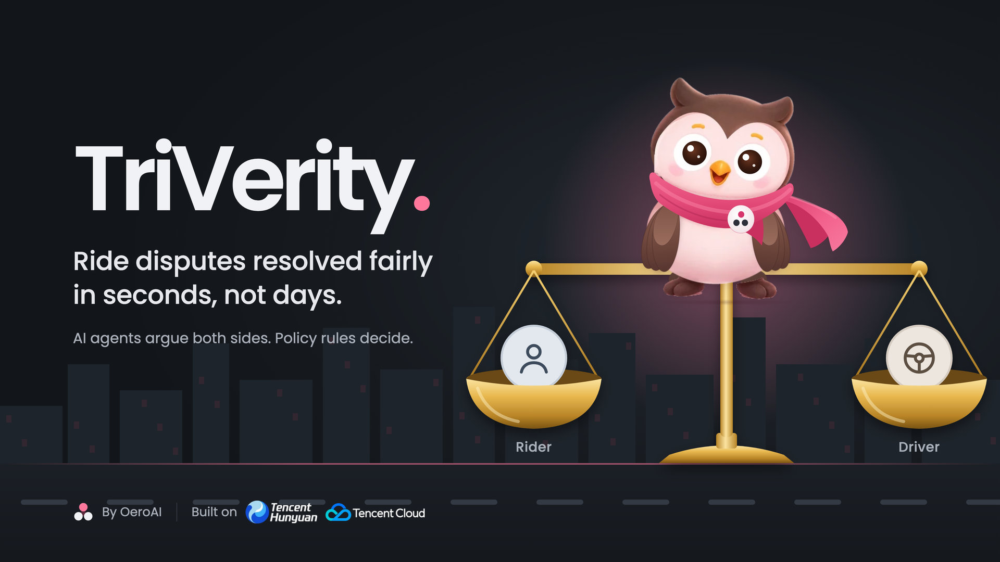](https://www.youtube.com/watch?v=aszYaflceGc)

# TriVerity: Multi-Agent Autonomous Dispute Resolution System

**Ride disputes resolved fairly in seconds, not days.**
AI agents argue both sides; policy rules decide fairly.

🏆 **Champion: First Prize (SGD 10,000) and Excellence Award** at the Tencent Cloud AI CAN DO IT Hackathon Singapore 2026,
co-hosted by AI Singapore: picked from the Top 10 finalists of ~150 teams (400+ registrations).

**▶ [Live demo](https://triverity-demo.onrender.com)** · **🎬 [Demo video](https://www.youtube.com/watch?v=aszYaflceGc)** ·
**🖼️ [Tencent Cloud project gallery](https://tch.tencentcloud.com/works/398)**

*A hackathon prototype by OeroAI, built for Ryde's challenge at the Tencent Cloud AI Hackathon Singapore 2026.
Not affiliated with or endorsed by Ryde. All dispute data is synthetic.*

> **About this repository.** This is TriVerity's public showcase: the overview, screenshots and demo video.
> The source code is private. Judges, employers and partners who'd like a walkthrough of the code can reach us
> through [our GitHub profile](https://github.com/yuzhihao1212).

| Speed and accuracy | Automation and fairness |
| --- | --- |
| **16–18 s** to a ruling, vs 24–72 h in the brief | **78%** resolved without a human (500 simulated disputes) |
| **9/9** sample rulings correct | **500/500** fairness checks: history removed or swapped |

Live sample measurements and offline simulation results; [measurement context below](#results).

## Watch it

[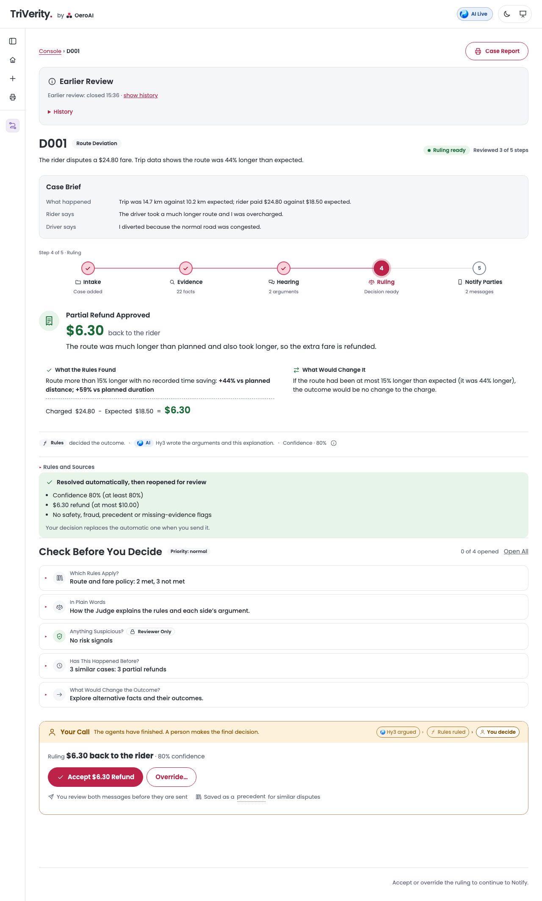](https://www.youtube.com/watch?v=aszYaflceGc)

**[Demo video on YouTube](https://www.youtube.com/watch?v=aszYaflceGc)**: a full walkthrough of the reviewer console,
from the queue to a ruling and the messages sent to the rider and driver. Or [try the live demo](https://triverity-demo.onrender.com)
on the sample disputes.

## A quick look

Select an image to view it full size.

<table width="100%">
<tr>
<td width="50%"><a href="docs/screenshots/01-landing.png">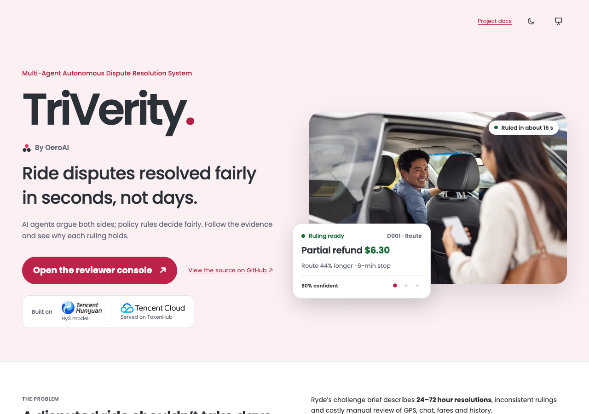</a> <strong>Meet TriVerity</strong></td>
<td width="50%"><a href="docs/screenshots/02-reviewer-home.png">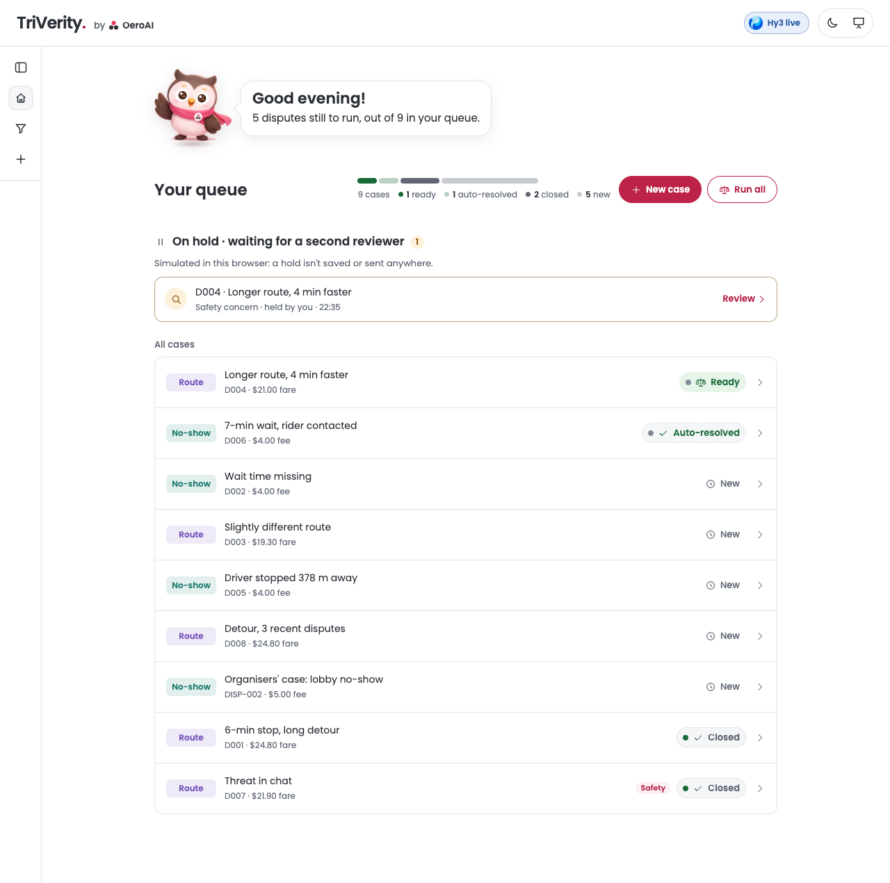</a> <strong>Pick the next case</strong></td>
</tr>
<tr>
<td width="50%"><a href="docs/screenshots/03-live-progress.png">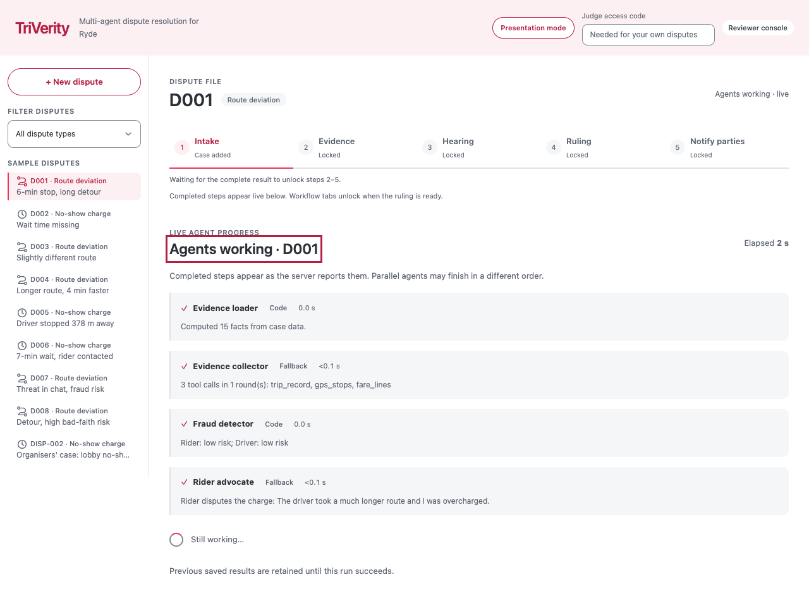</a> <strong>Watch the agents work</strong></td>
<td width="50%"><a href="docs/screenshots/04-evidence.png">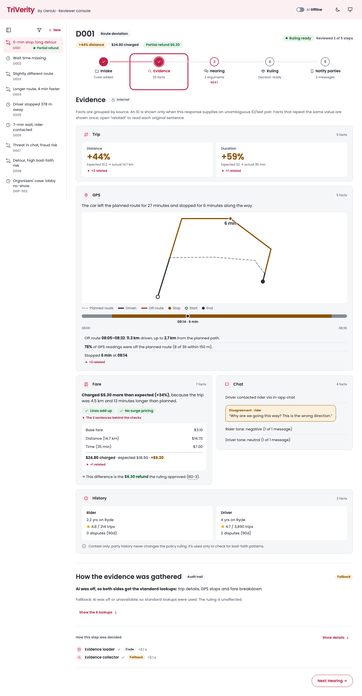</a> <strong>Check the evidence</strong></td>
</tr>
<tr>
<td width="50%"><a href="docs/screenshots/05-hearing.png">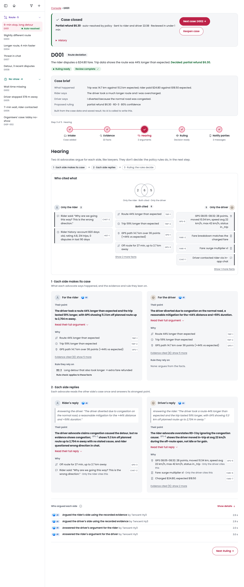</a> <strong>Hear both sides</strong></td>
<td width="50%"> <strong>Review the ruling</strong></td>
</tr>
<tr>
<td width="50%"><a href="docs/screenshots/07-notify.png">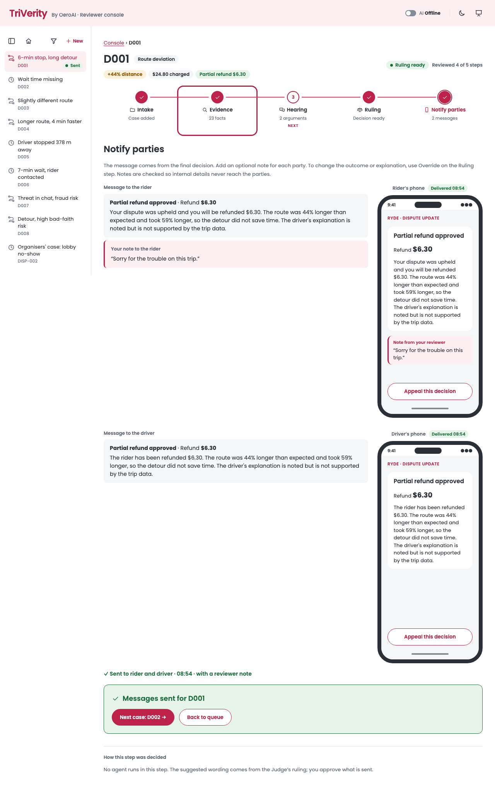</a> <strong>Approve the party messages</strong></td>
<td width="50%"><a href="docs/screenshots/08-closed-case.png">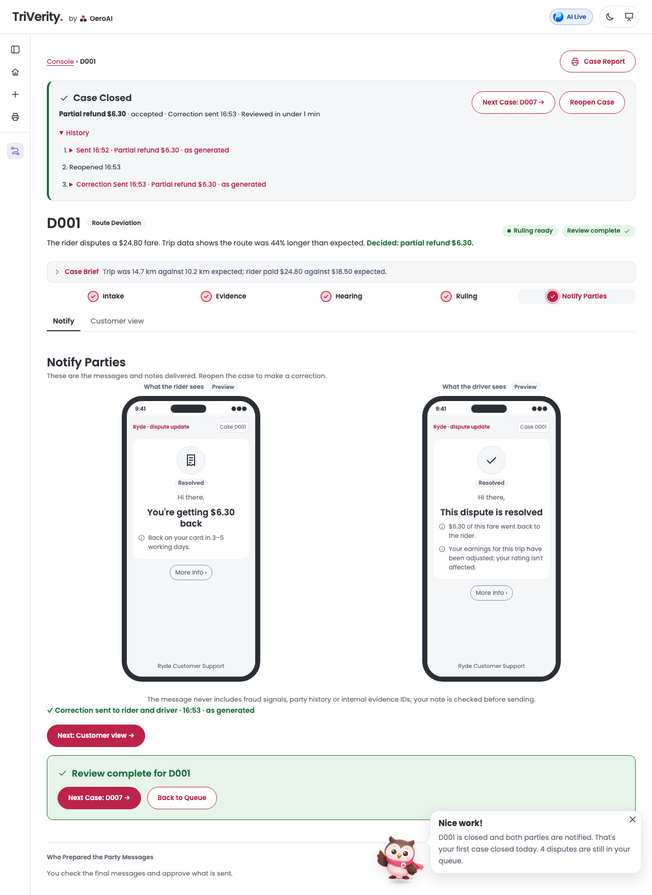</a> <strong>Keep a full history</strong></td>
</tr>
<tr>
<td width="50%"><a href="docs/screenshots/11-auto-resolved.png">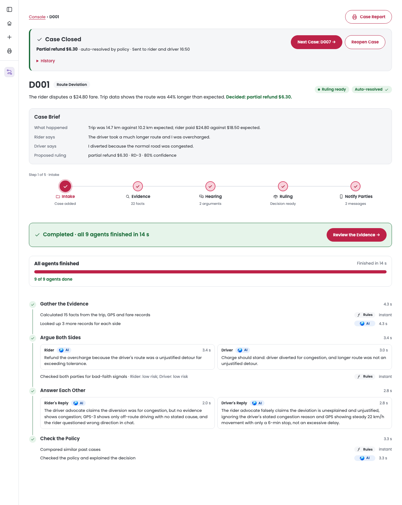</a> <strong>Routine cases close themselves</strong></td>
<td width="50%"><a href="docs/screenshots/12-rules-for-this-case.png">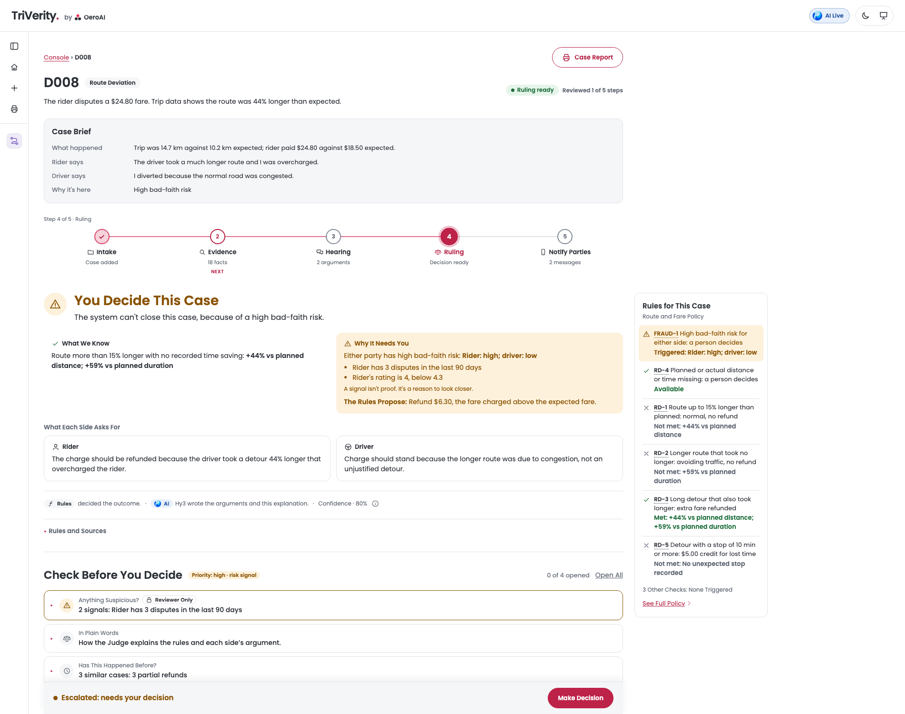</a> <strong>See every rule's result on this case</strong></td>
</tr>
<tr>
<td width="50%"><a href="docs/screenshots/13-case-report.png">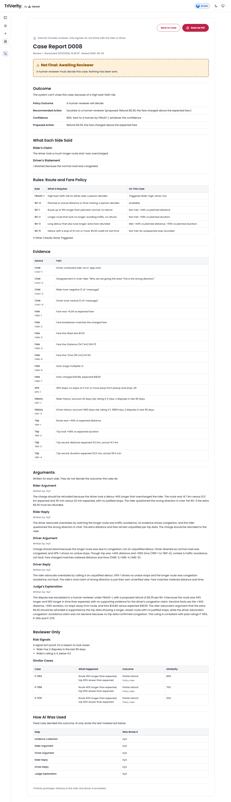</a> <strong>Save a case report as PDF</strong></td>
<td width="50%"><a href="docs/screenshots/15-first-visit-guide.png">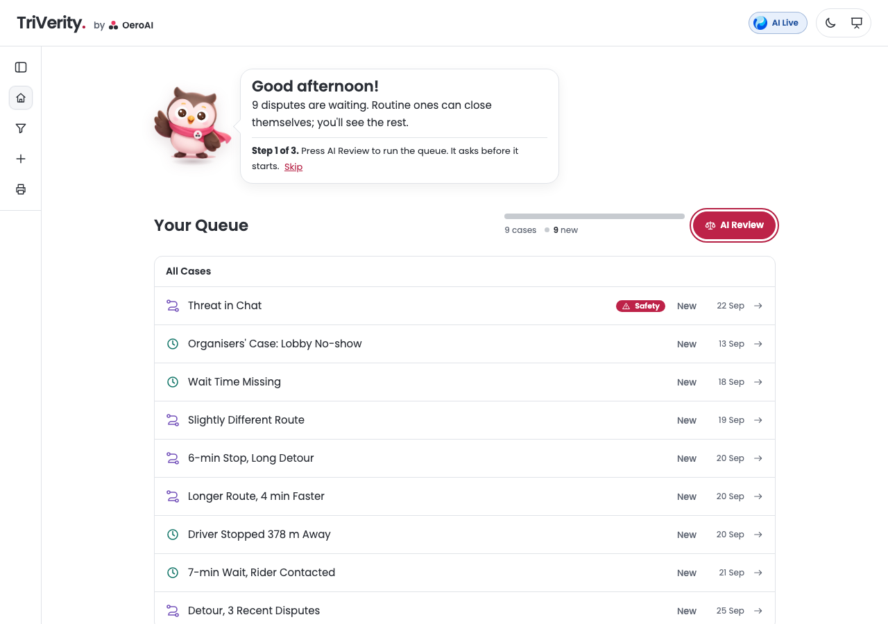</a> <strong>A guide on your first visit</strong></td>
</tr>
<tr>
<td width="50%"><a href="docs/screenshots/09-mobile.png">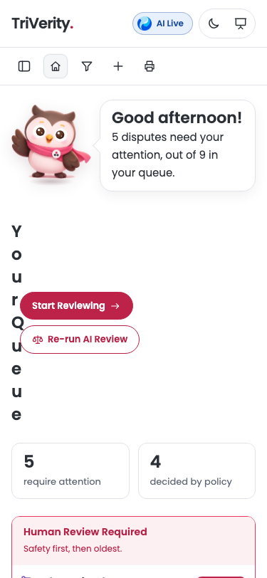</a> <strong>Works on a phone</strong></td>
<td width="50%"><a href="docs/screenshots/10-dark.png">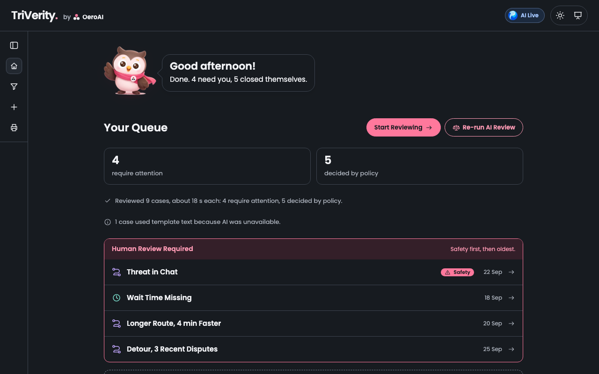</a> <strong>Dark mode</strong></td>
</tr>
</table>

## Architecture

[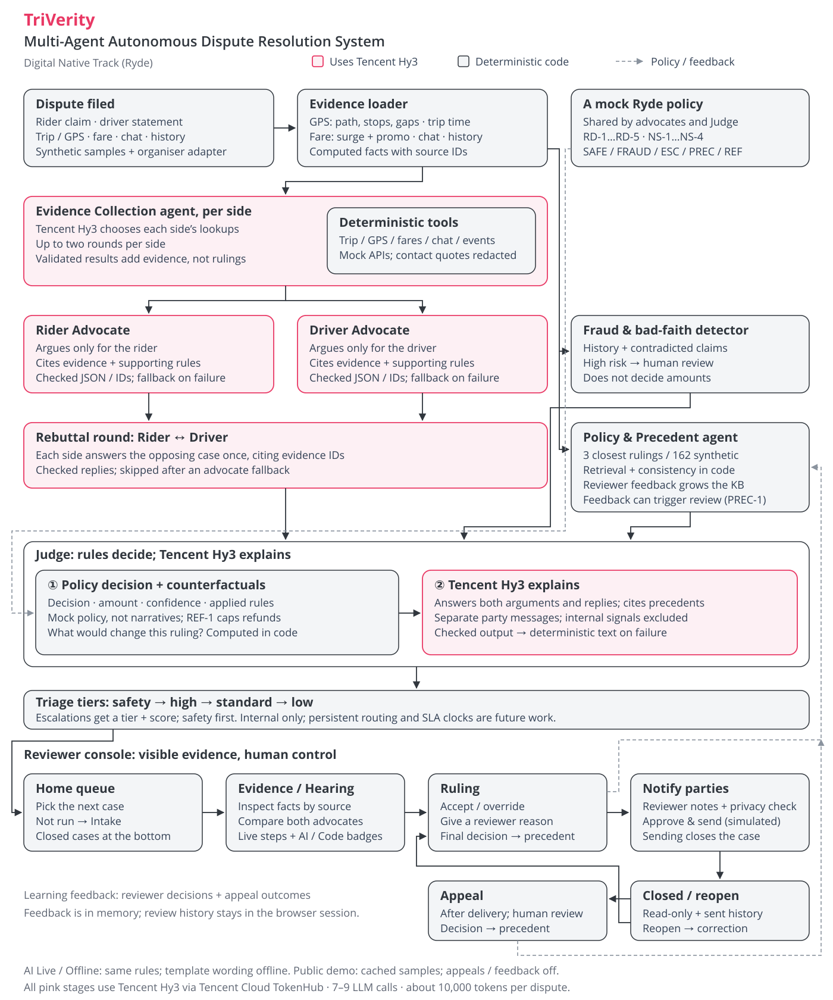](docs/architecture.svg)

## Results

Live evaluation against Tencent Hy3 on 16 Oct 2026, on the full pipeline (evidence collector, advocates,
rebuttal round, fraud detector, Policy & Precedent agent, Judge, triage) over the 9 sample disputes, including the
organisers' case:

| Measure | Result |
|---|---|
| Rulings matching the expected outcome (decision, refund, rules, review tier) | **9 / 9** |
| Agent outputs written by the AI (advocates, rebuttals, Judge) | **42 / 45** (the misses were one timeout and one over-long rebuttal, both caught by the checks) |
| Advocates citing a rule that favours the other side | **0 of 18** advocate cases |
| Rulings consistent with the closest past rulings | **8 / 9** (one case has no close precedent) |
| Time and cost per dispute | about 16–18 s and 10,000 tokens (7–9 LLM calls, about $0.002) |

The sample disputes are synthetic; these are measurements on them, not production data.

**At scale** (500 generated disputes run offline): 78% resolved without a human, the same facts always gave the
same ruling (100/100), the escalated 22% went to the review queue with a triage tier, and party history never
changed a policy decision (500/500 with histories removed or swapped).

## What it does

TriVerity resolves rider–driver disputes with a team of agents. A Rider Advocate and a Driver Advocate
each build their side's case from verified trip data, a Fraud detector checks both parties for bad-faith
patterns, and a Judge applies the platform's policy (a mock Ryde policy) to issue a ruling with a recommended
action, a confidence score and an explanation for each party.

**The AI argues and explains; policy rules decide.** Facts are computed in code, the decision comes from
the policy rules, and Tencent Hy3 writes each side's argument and the explanation of the outcome. So the
same facts always give the same ruling, and every ruling is explained.

- **Six agents**: Evidence Collection, Rider Advocate, Driver Advocate and Judge, powered by Tencent **Hy3**
  via Tencent Cloud TokenHub, plus a Fraud & Bad-Faith detector and a Policy & Precedent agent
- **Two dispute types** end to end: route deviation and no-show charge
- **Evidence** from trip data, GPS telemetry, fare breakdowns, chat logs and rider/driver history
- **Advocates cite evidence by ID**, so they can only cite facts that exist, then answer each other in a
  rebuttal round before the Judge rules
- **What would change the ruling**: every ruling states the facts it turned on and the outcome a different
  fact would give
- **Escalation and triage**: threats, a high bad-faith risk, missing data or low confidence send a case to a
  person, with a priority tier so safety cases come first
- **Auto-close for routine cases**: confident, small, flag-free cases close themselves and both parties are told
  how to appeal; a person can reopen any case
- **Learning loop**: reviewer decisions and appeals become precedents for future rulings
- **Reviewer workflow**: queue → Evidence → Hearing → Ruling (accept or override) → Notify, with holds,
  corrections and a printable case report

## Responsible AI

- **The AI never decides money.** Decisions, refund amounts and confidence come from policy rules, and a refund
  can never exceed the fare charged.
- **Every AI output is checked** before use. If a check fails, plain deterministic text is used and the console
  labels the step **Fallback** instead of **AI**.
- **Fraud signals stay internal.** They never appear in messages to the rider or the driver.
- **Prompt-injection red team.** Across 68 live runs of 17 catalogued attacks against Hy3, no injection changed
  the decision, amount, confidence or cited policy, and no attacker text reached a rider or driver.
- **No secrets in git**, rate limits and a daily token budget on the public demo.

## What's next

**Image evidence for damage and mess disputes** (the brief's third category). We left image analysis out of the
hackathon build on purpose: photos bring risks (faked or AI-generated images, instructions hidden in pictures,
faces and licence plates) that need proper safeguards first. The plan keeps the same principle: a vision model
only extracts facts from photos, and the policy rules still decide.

Also next: server-side lookup of trip data, persistence and SLA clocks for the review queue, and shadow-mode
agreement measured against Ryde's reviewers.

## Built with

Developed with Tencent Cloud **CodeBuddy** (LLM client, advocate agents, hardening, UI badges and the
Fraud & Bad-Faith detector), with **WorkBuddy** for the submission text, a docs consistency review and judge Q&A
preparation, and **Miora** for the original cover and owl artwork. The AI coding assistants **Claude Code**,
**OpenAI Codex** and **Kiro** helped build and review features. Every change went through a pull request,
automated tests and CI.

## Licence

Copyright © 2026 OeroAI. All rights reserved. See [LICENSE](LICENSE). The screenshots, artwork and text in this
repository may not be reused without permission.
