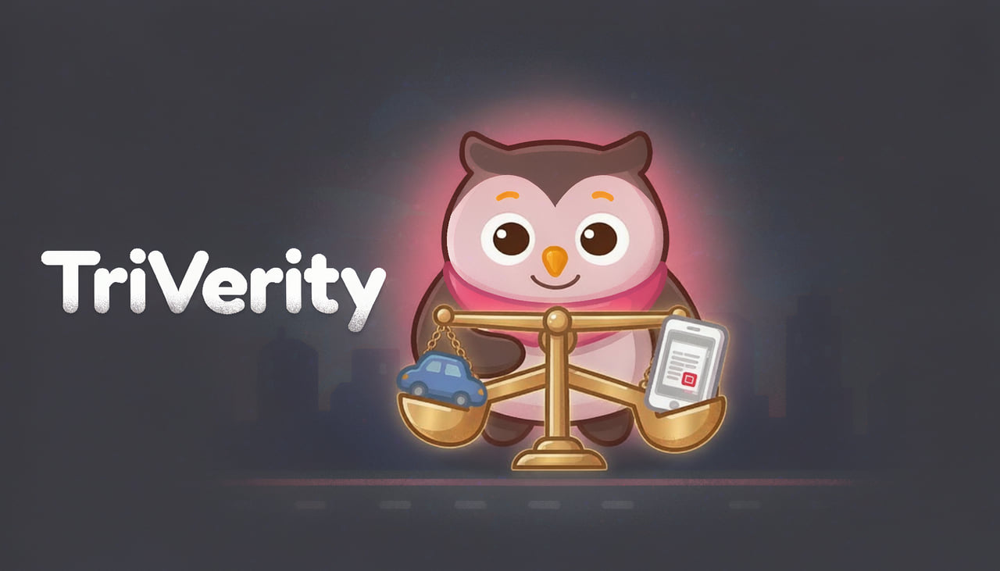
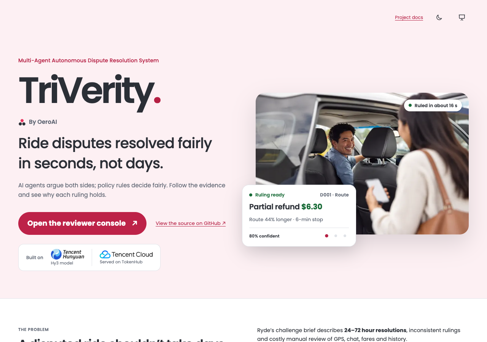
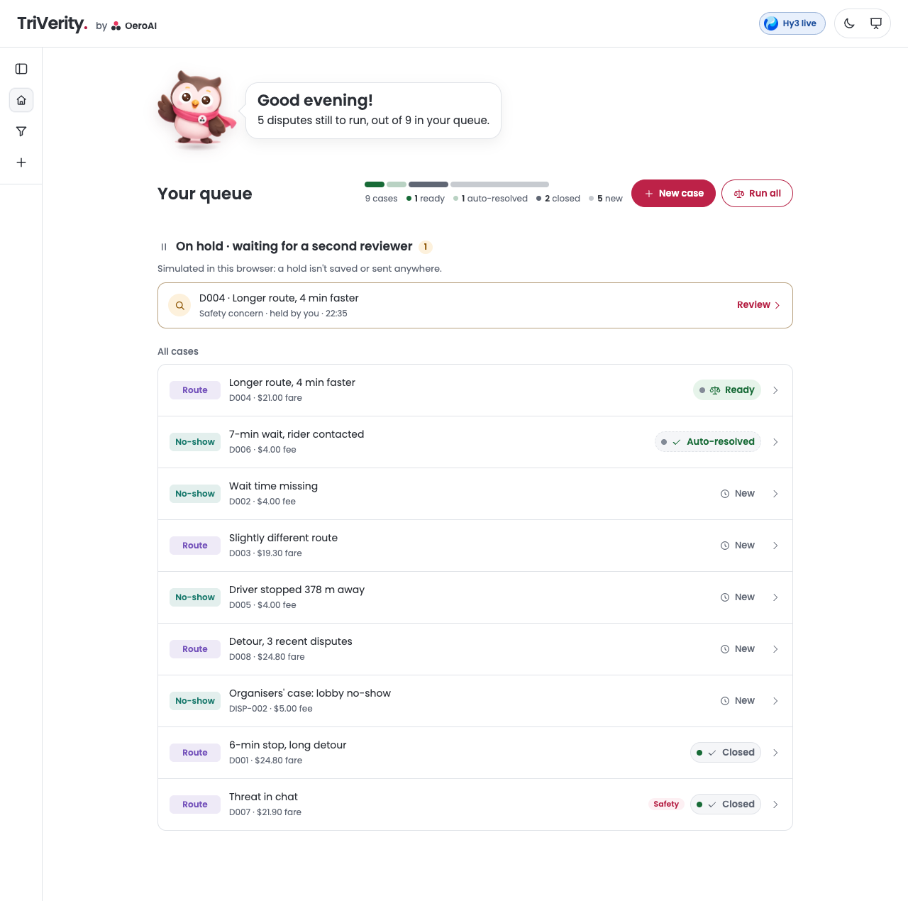
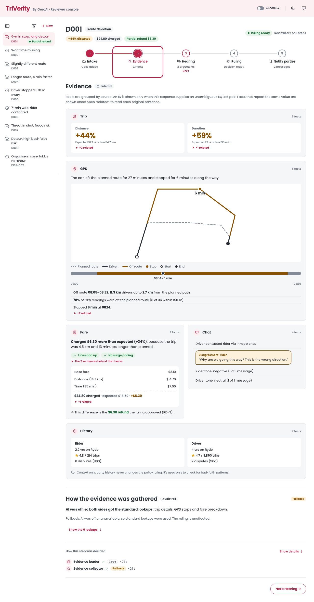
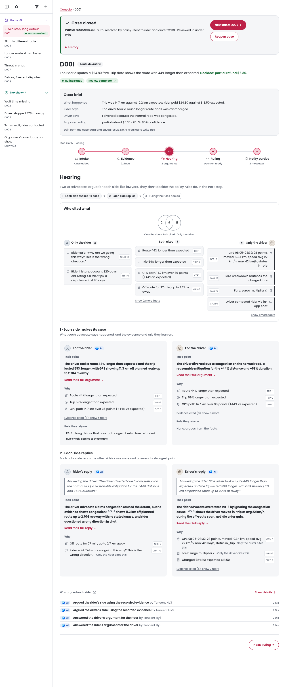
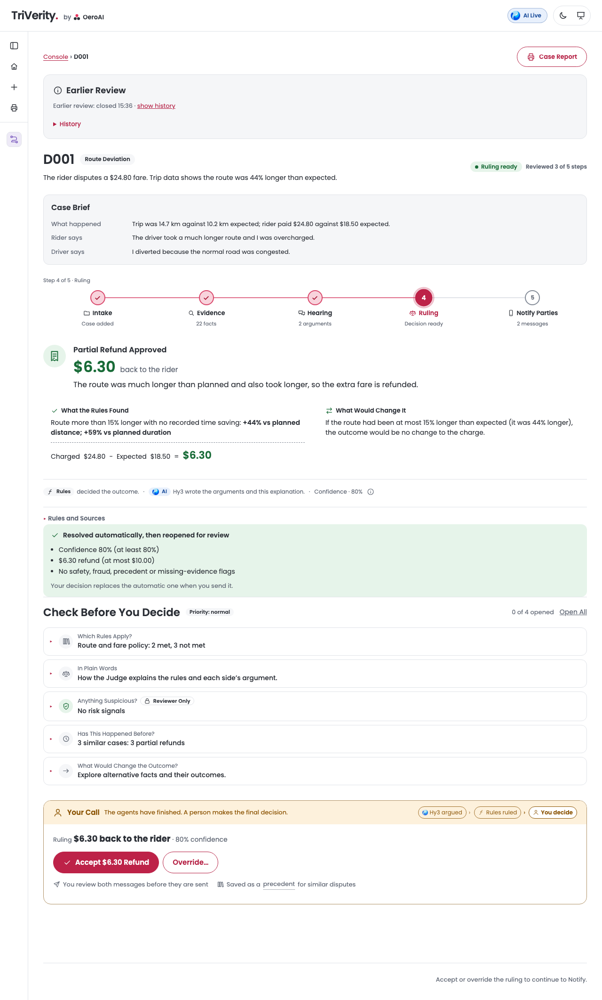
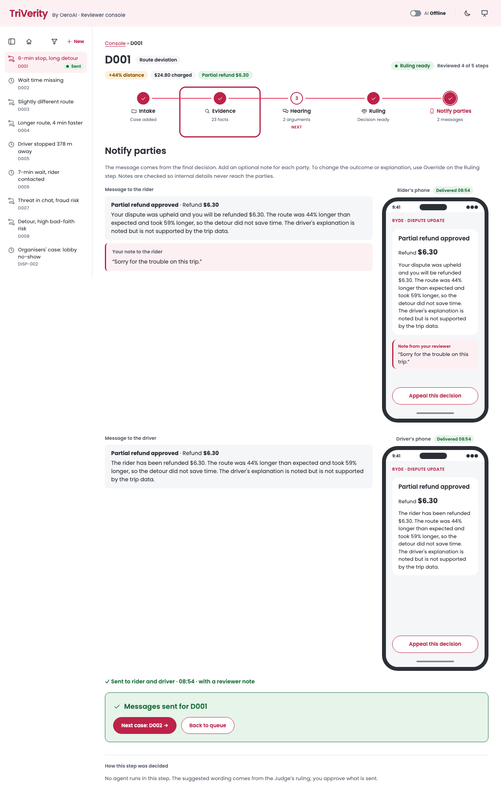
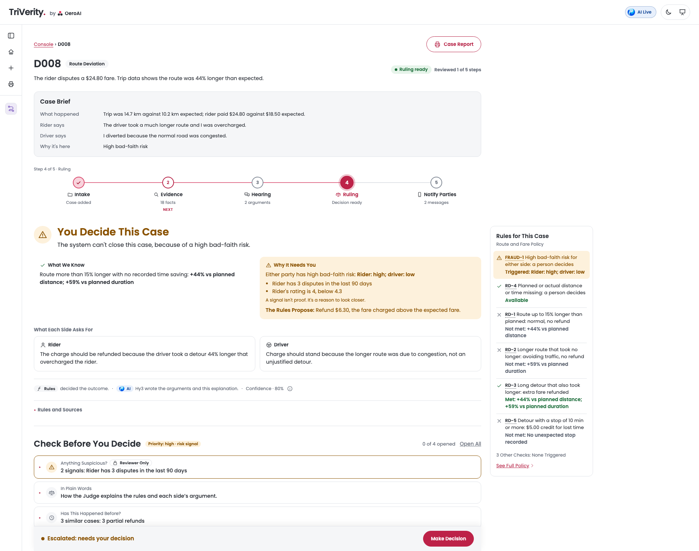
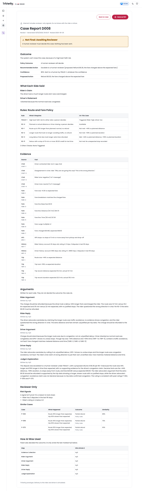

# TriVerity: Multi-Agent Autonomous Dispute Resolution System

**Ride disputes resolved fairly in seconds, not days.**
AI agents argue both sides; policy rules decide fairly.

**▶ [Live demo](https://triverity-demo.onrender.com)** · **🎬 [Demo video](https://www.youtube.com/watch?v=z3-8uuPBPAw)** ·
**📄 [AI tool usage evidence](docs/submission/ai-tool-evidence.pdf)** · **📋 [Ryde requirements →](#ryde-requirements-where-to-see-each)**

*A hackathon prototype by OeroAI, built for Ryde's challenge at the Tencent Cloud AI Hackathon Singapore 2026.
Not affiliated with or endorsed by Ryde. All dispute data is synthetic.*

| Speed and accuracy | Automation and fairness |
| --- | --- |
| **16–18 s** to a ruling, vs 24–72 h in the brief | **78%** resolved without a human (500 simulated disputes) |
| **9/9** sample rulings correct | **500/500** fairness checks: history removed or swapped |

Live sample measurements and offline simulation results; [measurement context below](#results).

## A quick look

Select an image to view it full size. [All fifteen screenshots and their provenance](docs/screenshots/README.md).

<table width="100%">
<tr>
<td width="50%"><a href="docs/screenshots/01-landing.png"></a><br><strong>Meet TriVerity</strong></td>
<td width="50%"><a href="docs/screenshots/02-reviewer-home.png"></a><br><strong>Pick the next case</strong></td>
</tr>
<tr>
<td width="50%"><a href="docs/screenshots/04-evidence.png"></a><br><strong>Check the evidence</strong></td>
<td width="50%"><a href="docs/screenshots/05-hearing.png"></a><br><strong>Hear both sides</strong></td>
</tr>
<tr>
<td width="50%"><a href="docs/screenshots/06-ruling.png"></a><br><strong>Review the ruling</strong></td>
<td width="50%"><a href="docs/screenshots/07-notify.png"></a><br><strong>Approve the party messages</strong></td>
</tr>
<tr>
<td width="50%"><a href="docs/screenshots/12-rules-for-this-case.png"></a><br><strong>See every rule's result on this case</strong></td>
<td width="50%"><a href="docs/screenshots/13-case-report.png"></a><br><strong>Save a case report as PDF</strong></td>
</tr>
</table>

## New for Demo Day

Added on 31 Oct 2026, after the hackathon submission. None of this changes the policy rules or how a ruling is decided;
it makes the console easier for a real reviewer to use. The demo video was recorded before these changes.

- **AI Review for the whole queue:** one button runs the waiting sample cases. Routine ones close themselves, and the
  rest stay in your queue, [safety first, then oldest](docs/screenshots/02-reviewer-home.png).
- **A first-visit guide:** [three short steps](docs/screenshots/15-first-visit-guide.png) from the queue to a decision,
  following what you've actually done. The owl gives the first two; the last is a plain note on the case.
- **A confirmation before it runs:** [AI Review says what it will do](docs/screenshots/14-ai-review-confirm.png), with
  the approximate AI cost and a warning that routine cases close and notify the rider and driver.
- **A measured result:** after a run, [the queue says how many cases ran, how long each took](docs/screenshots/02-reviewer-home.png)
  and how many need a person. The time comes from the agents' own log, so a saved sample reports its real run.
- **The answer first:** past Intake, the brief folds to one line, so the verdict sits
  [higher on the page](docs/screenshots/06-ruling.png). It opens with a click.
- **A plainer Ruling:** [it opens with the outcome and why](docs/screenshots/06-ruling.png), then what the rules found
  and what would change it. When a person must decide, it says [why, and what each side asks for](docs/screenshots/12-rules-for-this-case.png).
- **Bad-faith risk comes with its reasons:** an escalation lists every signal behind it, and says a signal isn't proof.
- **Rules for This Case:** [each rule's result on this case](docs/screenshots/12-rules-for-this-case.png), with the full
  policy one click away, so a reviewer doesn't have to remember it.
- **Case reports:** a [printable report for each case](docs/screenshots/13-case-report.png), saved as PDF from the
  browser. It opens from the case page or the side menu, says whether the outcome is final, says when no person was involved, and is marked internal.
- **Shorter Hearing cards:** [each side's point first](docs/screenshots/05-hearing.png), with the argument and evidence folded beneath it.
- **A simpler Evidence step:** [a list of findings](docs/screenshots/04-evidence.png), one source at a time, with flagged items first.
- **A livelier owl:** click it for a tip about how TriVerity works, watch it follow AI Review from the progress bar, and
  leave it alone for a minute to find it asleep. All of this happens on the home page, away from the cases themselves.
- **An owl to ask when you're lost:** on any case with a result, the owl in the corner answers questions such as "Why is this case with me?" and "What would change the outcome?". Answers come from the case's own rules and records and link to their sources. It makes no AI call and never recommends an outcome.
- **Clearer AI labels:** if AI Live is on but a result used fallback text, the Ruling says so and suggests a re-run.

## Architecture

[](docs/architecture.svg)

[Read the architecture](docs/architecture.md) · [Watch live progress](docs/screenshots/03-live-progress.png) · [Closed review and correction history](docs/screenshots/08-closed-case.png) · [A case that closed itself](docs/screenshots/11-auto-resolved.png)

**On this page:** [New for Demo Day](#new-for-demo-day) · [Results](#results) · [What it does](#what-it-does) · [Ryde requirements](#ryde-requirements-where-to-see-each) · [Documentation](#documentation) · [Run it locally](#run-it-locally) · [What's next](#whats-next) · [Built with](#built-with)

## Results

Live evaluation against Tencent Hy3 on 16 Oct 2026, on the full pipeline (evidence collector, advocates,
rebuttal round, fraud detector, Policy & Precedent agent, Judge, triage) over the 9 sample disputes, including the
organisers' case:

| Measure | Result |
|---|---|
| Rulings matching the expected outcome (decision, refund, rules, review tier) | **9 / 9** (`scripts/evaluate.py`) |
| Agent outputs written by the AI (advocates, rebuttals, Judge) | **42 / 45** (45/45 before the evidence collector; the misses were one timeout, which also skipped that case's rebuttals, and one over-long rebuttal, both caught by the checks) |
| Advocates citing a rule that favours the other side | **0 of 18** advocate cases (2 of 32 in an earlier 4-run check) |
| Rulings consistent with the closest past rulings | **8 / 9** (D002 has no close precedent: its waiting time is missing) |
| Time and cost per dispute | about 16–18 s and 10,000 tokens (7–9 LLM calls, about $0.002) |

The sample disputes are synthetic; these are measurements on them, not production data.

**At scale** ([simulation.md](docs/simulation.md), 500 generated disputes run offline): 78% resolved without a
human, the same facts always gave the same ruling (100/100), the escalated 22% went to the review queue
with a triage tier, and party history never changed a policy decision (500/500 with histories removed or swapped). At an illustrative 5,000 disputes a day, AI costs about $10 a day while freeing an estimated 325–975 reviewer
hours ([business case](docs/business-case.md), with its assumptions stated).

## What it does

TriVerity resolves rider–driver disputes with a team of agents. A Rider Advocate and a Driver Advocate
each build their side's case from verified trip data, a Fraud detector checks both parties for bad-faith
patterns, and a Judge applies the platform's policy (a mock Ryde policy) to issue a ruling with a recommended action, a confidence
score and an explanation for each party.

**The AI argues and explains; policy rules decide.** Facts are computed in code, the decision comes from
the policy rules, and Tencent Hy3 writes each side's argument and the explanation of the outcome. So the
same facts always give the same ruling, and every ruling is explained.

- **Six agents**: an **Evidence Collection agent** (each advocate requests its own evidence), Rider Advocate, Driver Advocate and Judge, powered by
  Tencent **Hy3** via Tencent Cloud TokenHub, plus a deterministic **Fraud & Bad-Faith detector** and a
  **Policy & Precedent agent**
- **Two dispute types** end to end: route deviation and no-show charge
- **Evidence** from trip data, GPS telemetry (path length, unexpected stops, data gaps), fare breakdowns
  (surge and promo checks), chat logs and rider/driver history, grouped by source with an ID per fact
- **Advocates gather and cite evidence by ID**, so they can only cite facts that exist, then **answer each
  other in a rebuttal round** before the Judge rules
- **The organisers' dataset format** is read directly: files in `data/organiser/` are converted and appear
  in the demo as extra samples
- **Output**: ruling (refund, compensation or no action), recommended action (e.g. refund $6.30), confidence, cited policy, a neutral
  explanation and separate messages to the rider and the driver
- **Precedents (RAG)**: the Policy & Precedent agent retrieves the closest past rulings; the Judge cites them
  in the case record, and the evaluation checks each ruling's consistency with them
- **The Judge weighs both sides**: every rule each advocate cited is checked against the facts (holds for them,
  favours the other side, or doesn't apply) and the deciding rule is marked
- **What would change the ruling**: every ruling states the facts it turned on and the outcome a different
  fact would give (counterfactual explanations), computed from the policy and verified by the tests
- **Review triage**: escalated disputes get a priority tier (safety, high, standard, low), a score and
  the reasons, so safety cases are reviewed first; internal only, like the fraud signals
- **Appeals**: a rider or driver can appeal a ruling; a human reviewer decides, and the decision becomes a
  precedent, which closes the loop (dispute → AI ruling → appeal → human → system learns)
- **Learning feedback loop**: a reviewer's decision becomes a precedent; when reviewers keep deciding
  similar cases differently from the rules, those disputes go to a human (`PREC-1`)
- **Escalation** to a human reviewer for threats in chat, a high bad-faith risk, missing data, low
  confidence or reviewer precedents against the rules, with the proposed action attached for the reviewer
- **Auto-close for routine cases**: when the rules are confident (at least 80%), the refund is small (at most
  $10) and nothing needs a person (no safety, fraud, precedent or missing-data flag), the case
  [closes itself](docs/screenshots/11-auto-resolved.png) and both parties are told, including how to appeal.
  5 of the 9 samples close this way. A repeatable ~10% sample still goes to a reviewer, a reviewer can reopen any
  case, and automatic decisions never become precedents
- **Observable**: the demo UI shows the evidence, each agent's argument and citations, the fraud risk, and
  whether the AI or the fallback produced each step
- **Reviewer workflow**: home queue (**AI Review** runs the waiting cases, after a confirmation) → Evidence → Hearing → Ruling (accept or override) → Notify
  (optional reviewer note and privacy check). Internal IDs and assessments in a note block sending;
  everyday words such as "history" only warn. Sending closes the case; a deliberate reopen permits a
  correction, while history keeps every sent message. An investigation or a refund above the reviewer's
  limit puts the case on hold (simulated) and nobody is notified. Parties can appeal after delivery.
  Review state, including holds, is kept in the browser session. Any case with a result can be saved as a
  [PDF report](docs/screenshots/13-case-report.png).

## Responsible AI and security

The full threat model is in [docs/security.md](docs/security.md).

- **The AI never decides money.** Decisions, refund amounts and confidence come from policy rules; a refund
  can never exceed the fare charged (rule `REF-1`).
- **Every AI output is checked** for wrong amounts, rules nobody cited, refund promises on escalated cases,
  links, markup and leaks of internal data. If a check fails, deterministic text is used, and the UI labels
  the step **Fallback** instead of **AI**.
- **Fraud signals stay internal.** They never appear in messages to the rider or the driver, and the API
  offers rider-only and driver-only views (`?view=rider|driver`) without them.
- **Prompt-injection red team.** Rider and driver text is treated as untrusted data. We catalogued 23 attacks
  (`backend/tests/attacks.py`); across 17 of them and 68 live runs against Hy3, no injection changed the
  decision, amount, confidence or cited policy, and no attacker text reached a rider or driver
  ([findings](docs/redteam/findings.md)). Attacker text can still appear in an advocate's argument inside
  the internal reviewer console, where it is labelled as an unverified argument and never decides anything.
- **API hardening**: input size and range limits, rate limits per IP and overall, a daily token budget
  (after which the app keeps working with fallback text), a cap on concurrent resolves, and timeouts.
- **Public demo mode** (`PUBLIC_DEMO=true`): visitors can only run the server's own sample disputes, with
  cached results and the API docs hidden; invited judges get personal, revocable access codes to submit
  their own disputes. See [docs/demo-deployment.md](docs/demo-deployment.md).
- **Secrets and supply chain**: no keys in git (gitleaks and trufflehog over the full history, plus a
  gitleaks pre-commit hook and CI job), pinned Python dependencies, dependency audits in CI, and logs that
  record error types but never error text or personal data.

## Ryde requirements, where to see each

| Ryde brief | Where to see it |
| --- | --- |
| **Rider Advocate, Driver Advocate and Judge agents** | [Hearing](docs/screenshots/05-hearing.png), [Ruling](docs/screenshots/06-ruling.png), [agent source](backend/app/agents/) |
| **GPS and telemetry**: actual vs optimal route, unexpected stops, duration vs estimate | [Evidence: route sketch, timeline and GPS card](docs/screenshots/04-evidence.png) |
| **Chat logs**: sentiment, agreements, disagreements, threats | [Evidence](docs/screenshots/04-evidence.png); [computed chat facts and SAFE-1](docs/architecture.md#flow) |
| **Payment and fare data**: breakdown validation, surge, promo codes | [Evidence: Fare card verdict and checks](docs/screenshots/04-evidence.png) |
| **Historical behaviour**: dispute history, ratings, account age | [Evidence: History card](docs/screenshots/04-evidence.png); [500/500 policy fairness checks](docs/simulation.md) |
| **Advocates gather their own evidence and cite policy** | [Per-side collection tools](docs/architecture.md#flow); [Hearing key facts and cited rules](docs/screenshots/05-hearing.png) |
| **Ruling with a confidence score and a plain-language explanation** | [Ruling: outcome, confidence, reason, what would change it](docs/screenshots/06-ruling.png) |
| **Recommended action and an explanation to both parties** | [Ruling: e.g. partial refund $6.30](docs/screenshots/06-ruling.png); [Notify: reviewer-approved party messages](docs/screenshots/07-notify.png) |
| **At least two dispute categories, end to end** | [Sample data](data/disputes/): route deviation (D001, D003, D004, D007, D008), no-show charge (D002, D005, D006); [organisers' DISP-002](data/organiser/disp_002.json) |
| **Observable inter-agent communication** | [Live progress](docs/screenshots/03-live-progress.png), [Hearing](docs/screenshots/05-hearing.png), [streamed agent log](docs/api-contract.md#post-apidisputesresolvestream); “How this step was decided” on every console step |
| **Architecture diagram** | [Diagram](docs/architecture.svg), [design explanation](docs/architecture.md) |
| **Stretch: Evidence Collection agent** | [Per-side tool calls over mock Ryde data APIs](docs/architecture.md#flow) |
| **Stretch: Fraud & Bad-Faith detection** | [Deterministic risk from history and contradicted claims](docs/architecture.md#flow); [Ruling, with the reasons listed](docs/screenshots/12-rules-for-this-case.png). Risk scores feed the Judge; the Evidence History card stays neutral. |
| **Stretch: Policy & Precedent agent** | [Retrieval and reviewer feedback](docs/architecture.md#flow); [Ruling](docs/screenshots/06-ruling.png) |
| **Stretch: Escalation protocol** | [Priority tiers](docs/architecture.md#review-triage-and-the-queue-and-sla-layer-it-feeds): low confidence, threats, missing data or high risk → human review |
| **Stretch: Learning feedback loop** | [Reviewer decisions and appeals become precedents](docs/architecture.md#flow); [closed-case corrections and history](docs/screenshots/08-closed-case.png) |
| **Stretch: SLA and routing** | [Triage and production SLA extension](docs/architecture.md#review-triage-and-the-queue-and-sla-layer-it-feeds); [reviewer queue](docs/screenshots/02-reviewer-home.png). Tiers are safety, high, standard and low; cases needing a decision come first. Persistent routing and SLA clocks are not built. |
| **Stretch: Image analysis** | Not built, on purpose; see [What's next](#whats-next) |

## Documentation

[Documentation index](docs/README.md): architecture, responsible AI, security, evaluation, business case,
API, deployment, submission and milestones, each with a short description.

**Verified on 31 Oct 2026:** 975 backend tests and 450 frontend tests pass. Tests never call a real LLM.

## Run it locally

<details>
<summary>Run it locally — prerequisites, setup, environment and checks</summary>

### Prerequisites

- **Python 3.10 or newer** (the code uses `match` statements and `X | None` types; CI runs 3.12)
- **Node.js 18, or 20 or newer** (required by Vite 5)
- Git

Check with `python3 --version` and `node --version`.

### Backend

```bash
cd backend
python -m venv .venv
source .venv/bin/activate   # Windows: .venv\Scripts\activate
pip install -r requirements.txt
uvicorn app.main:app --reload
```

API docs: `http://127.0.0.1:8000/docs`

To use the LLM, create `backend/.env` (git-ignored) with a Tencent Cloud TokenHub key:

```
LLM_API_KEY=your-key
LLM_BASE_URL=https://tokenhub-intl.tencentcloudmaas.com/v1
LLM_MODEL=hy3
LLM_DISABLE_THINKING=true
```

For local development also add **Preset 1** from `.env.example`: the default limit of 3 resolves a minute
per IP applies to everyone on `127.0.0.1`. Without a key everything still runs, using deterministic
fallbacks in place of the LLM.

### Frontend

```bash
cd frontend
npm install
npm run dev
```

Open `http://localhost:5173`, open the reviewer console, pick a sample dispute and press **Run Agents**. Each run
makes 7–9 LLM calls (about 10,000 tokens); switch **AI Live** to **AI Off** in the header to run it free.

### Tests and evaluation

```bash
cd backend
pip install -r requirements-dev.txt   # once: adds pytest to the pinned runtime packages
pytest
```

Tests never call a real LLM. To measure the live system (this spends real tokens), from the repo root:

```bash
python scripts/evaluate.py --runs 3
```

Optional: `pip install pre-commit && pre-commit install` adds the gitleaks secret check to every commit.

## Repository layout

```text
backend/        FastAPI API, agents, orchestration, models, tests
frontend/       React + TypeScript demo UI
data/           Sample disputes, the organisers' cases, expected rulings and the mock Ryde policy
docs/           Architecture, prompts, security, evaluation, deployment, API contract, milestones
scripts/        evaluate.py, run_sample.py, red-team and demo setup scripts
```

</details>

## What's next

**Image evidence for damage and mess disputes** (the brief's third category). We deliberately didn't ship image
analysis in the hackathon: photos bring risks (faked or AI-generated images, instructions hidden in pictures,
faces and licence plates) that need proper safeguards, and a half-built version would undermine the trust the
rest of the system is built on. The design keeps the same principle, rules decide and AI explains:

- A vision-capable model only **extracts facts** from photos (type and severity of mess or damage) as evidence
  with IDs; the policy rules still decide any cleaning fee.
- **Authenticity checks:** the photo's time and place must match the trip's end; edited or AI-generated images
  are flagged; every image case starts with human review until accuracy is measured.
- **Security and privacy:** text inside images is untrusted data (as in the prompt-injection tests); file type,
  size and count limits; faces and licence plates blurred before anything is stored or shown; photos kept only
  while the dispute is open.
- **Evaluation first:** a labelled test set and red-team images before any live use.

**Guided onboarding for non-technical reviewers:** a spotlight tour on a recorded run of a
sample case that explains what each agent contributes and where the human stays in control
([design and storyboard](docs/onboarding-tour.md)).

Also next: server-side lookup of trip data (instead of trusting submitted facts), persistence and SLA clocks for
the review queue, and shadow-mode agreement measured against Ryde's reviewers.

## Built with

Developed with Tencent Cloud **CodeBuddy** (LLM client, advocate agents, hardening, UI badges and the
Fraud & Bad-Faith detector), with **WorkBuddy** for the submission text, a docs consistency review and judge Q&A
preparation, and **Miora** for the cover image. The AI coding assistants **Claude Code**, **OpenAI Codex** and
**Kiro** helped build and review features. Every change went through a pull request, automated tests and CI.

### How we built it: reflection and tips

**Our approach:** we decided early that the AI would argue and explain, but never decide. That one rule shaped
everything: facts are computed in code, policy rules make the ruling, and every AI output is checked before use,
so a bad model reply can only make the wording worse, never the outcome. We built in small pull requests, each
with tests and CI, and measured on live Hy3 before claiming any number.

**Tips for building with AI coding tools**
- **Be specific.** Name the files, the function and the tests that must pass. Our best CodeBuddy results came from
  prompts like that; vague prompts produced plausible code in the wrong place.
- **Turn failures into rules.** Every rule in our prompts and output checks exists because live Hy3 output broke
  it once. For example, advocates cited rules that favoured the other side (9 times in 14 cases) until a prompt
  change cut it to 2 ([prompts.md](docs/prompts.md)).
- **Verify everything.** We checked every AI change with tests (1,425 in total) and every AI-written claim against
  the code. WorkBuddy's consistency review of our own docs found facts that had drifted between files.
- **Use tools for what they're good at.** CodeBuddy for the AI core, WorkBuddy as a reviewer of our writing,
  Miora for visuals, and Claude Code, OpenAI Codex and Kiro for features, refactors and code review, all
  through the same pull-request process, so every change was reviewed and tested whichever tool wrote it.
- **Write hand-off-ready prompts.** Give each task a self-contained spec (goal, files, constraints, tests). When
  one assistant hit its usage limit mid-feature, another picked up from the same spec and the open branch.
- **Ship the safe version.** We left image evidence out rather than ship it without authenticity and privacy
  safeguards (see [What's next](#whats-next)).
