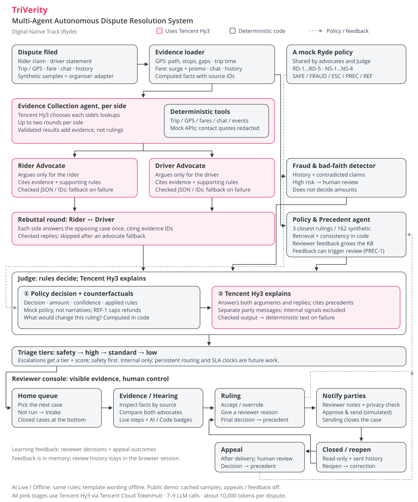

# TriVerity

**Digital Native Track (Ryde): Multi-Agent Autonomous Dispute Resolution System**

TriVerity resolves rider–driver disputes with a team of agents. A Rider Advocate and a Driver Advocate
each build their side's case from verified trip data, a Fraud detector checks both parties for bad-faith
patterns, and a Judge applies Ryde's policy to issue a ruling with a recommended action, a confidence
score and an explanation for each party.

**The AI argues and explains; policy rules decide.** Facts are computed in code, the decision comes from
Ryde's policy rules, and Tencent Hy3 writes each side's argument and the explanation of the outcome. So the
same facts always give the same ruling, and every ruling is explained.



## Results

Live evaluation against Tencent Hy3 on 16 Oct 2026, on the full pipeline (evidence collector, advocates,
rebuttal round, fraud detector, Policy & Precedent agent, Judge, triage) over the 9 sample disputes, including the
organisers' case:

| Measure | Result |
|---|---|
| Rulings matching the expected outcome (decision, refund, rules, review tier) | **9 / 9** (`scripts/evaluate.py`) |
| Agent outputs written by the AI (advocates, rebuttals, Judge) | **42 / 45** (45/45 before the evidence collector; the misses were one timeout, which also skipped that case's rebuttals, and one over-long rebuttal, both caught by the checks) |
| Advocates citing a rule that favours the other side | **0 of 18** advocate cases (2 of 32 in an earlier 4-run check) |
| Rulings consistent with the closest past rulings | **8 / 9** (D002 has no close precedent: its waiting time is missing) |
| Time and cost per dispute | about 16 s and 8,000 tokens (6–7 LLM calls, about $0.002) |

The sample disputes are synthetic; these are measurements on them, not production data.

## What it does

- **Six agents**: an **Evidence Collection agent**, Rider Advocate, Driver Advocate and Judge, powered by
  Tencent **Hy3** via Tencent Cloud TokenHub, plus a deterministic **Fraud & Bad-Faith detector** and a
  **Policy & Precedent agent**
- **Two dispute types** end to end: route deviation and no-show charge
- **Evidence** from trip data, GPS telemetry (path length, unexpected stops, data gaps), fare breakdowns
  (surge and promo checks), chat logs and rider/driver history, grouped by source with an ID per fact
- **Advocates gather and cite evidence by ID**, so they can only cite facts that exist, then **answer each
  other in a rebuttal round** before the Judge rules
- **The organisers' dataset format** is read directly: files in `data/organiser/` are converted and appear
  in the demo as extra samples
- **Output**: ruling, recommended action (e.g. refund $6.30), confidence, cited policy, a neutral
  explanation and separate messages to the rider and the driver
- **Precedents (RAG)**: the Policy & Precedent agent retrieves the closest past rulings; the Judge cites them
  in the case record, and the evaluation checks each ruling's consistency with them
- **Review triage**: escalated disputes get a priority tier (safety, high, standard, low), a score and
  the reasons, so safety cases are reviewed first; internal only, like the fraud signals
- **Learning feedback loop**: a reviewer's decision becomes a precedent; when reviewers keep deciding
  similar cases differently from the rules, those disputes go to a human (`PREC-1`)
- **Escalation** to a human reviewer for threats in chat, a high bad-faith risk, missing data, low
  confidence or reviewer precedents against the rules, with the proposed action attached for the reviewer
- **Observable**: the demo UI shows the evidence, each agent's argument and citations, the fraud risk, and
  whether the AI or the fallback produced each step

## Responsible AI and security

The full threat model is in [docs/security.md](docs/security.md).

- **The AI never decides money.** Decisions, refund amounts and confidence come from policy rules; a refund
  can never exceed the fare charged (rule `REF-1`).
- **Every AI output is checked** for wrong amounts, rules nobody cited, refund promises on escalated cases,
  links, markup and leaks of internal data. If a check fails, deterministic text is used, and the UI labels
  the step **Fallback** instead of **AI**.
- **Fraud signals stay internal.** They never appear in messages to the rider or the driver, and the API
  offers rider-only and driver-only views (`?view=rider|driver`) without them.
- **Prompt-injection red team.** Rider and driver text is treated as untrusted data. We catalogued 23 attacks
  (`backend/tests/attacks.py`); across 17 of them and 68 live runs against Hy3, no injection changed the
  decision, amount, confidence or cited policy, and no attacker text reached a rider or driver
  ([findings](docs/redteam/findings.md)). Attacker text can still appear in an advocate's argument inside
  the internal reviewer console, where it is labelled as an unverified argument and never decides anything.
- **API hardening**: input size and range limits, rate limits per IP and overall, a daily token budget
  (after which the app keeps working with fallback text), a cap on concurrent resolves, and timeouts.
- **Public demo mode** (`PUBLIC_DEMO=true`): visitors can only run the server's own sample disputes, with
  cached results and the API docs hidden; invited judges get personal, revocable access codes to submit
  their own disputes. See [docs/demo-deployment.md](docs/demo-deployment.md).
- **Secrets and supply chain**: no keys in git (gitleaks and trufflehog over the full history, plus a
  gitleaks pre-commit hook and CI job), pinned Python dependencies, dependency audits in CI, and logs that
  record error types but never error text or personal data.

## Docs

- [Architecture](docs/architecture.md): flow, design principles, checks on LLM output
- [Prompts](docs/prompts.md): how the prompts drive each agent, and what testing changed
- [Submission](docs/submission.md): title, blurb and project description for the hackathon form
- [Security](docs/security.md): threat model, red-team results, API hardening, residual risks
- [Evaluation](docs/evaluation.md): how rulings, AI rate and citations are measured
- [Demo deployment](docs/demo-deployment.md): running the public demo safely
- [API contract](docs/api-contract.md): request and response format
- [Milestones](docs/milestones.md): progress against the brief and the submission checklist

## Repository layout

```text
backend/        FastAPI API, agents, orchestration, models, tests
frontend/       React + TypeScript demo UI
data/           Sample disputes, the organisers' cases, expected rulings and the mock Ryde policy
docs/           Architecture, prompts, security, evaluation, deployment, API contract, milestones
scripts/        evaluate.py, run_sample.py, red-team and demo setup scripts
```

## Getting started

### Prerequisites

- **Python 3.10 or newer** (the code uses `match` statements and `X | None` types; CI runs 3.12)
- **Node.js 18, or 20 or newer** (required by Vite 5)
- Git

Check with `python3 --version` and `node --version`.

### Backend

```bash
cd backend
python -m venv .venv
source .venv/bin/activate   # Windows: .venv\Scripts\activate
pip install -r requirements.txt
uvicorn app.main:app --reload
```

API docs: `http://127.0.0.1:8000/docs`

To use the LLM, create `backend/.env` (git-ignored) with a Tencent Cloud TokenHub key:

```
LLM_API_KEY=your-key
LLM_BASE_URL=https://tokenhub-intl.tencentcloudmaas.com/v1
LLM_MODEL=hy3
LLM_DISABLE_THINKING=true
```

For local development also add **Preset 1** from `.env.example`: the default limit of 3 resolves a minute
per IP applies to everyone on `127.0.0.1`. Without a key everything still runs, using deterministic
fallbacks in place of the LLM.

### Frontend

```bash
cd frontend
npm install
npm run dev
```

Open `http://localhost:5173`, pick a sample dispute and press **Resolve dispute**. Each run makes six or seven
LLM calls (about 8,000 tokens).

### Tests and evaluation

```bash
cd backend
pip install -r requirements-dev.txt   # once: adds pytest to the pinned runtime packages
pytest
```

Tests never call a real LLM. To measure the live system (this spends real tokens), from the repo root:

```bash
python scripts/evaluate.py --runs 3
```

Optional: `pip install pre-commit && pre-commit install` adds the gitleaks secret check to every commit.

## Built with

Developed with Tencent Cloud **CodeBuddy** (LLM client, advocate agents, hardening, UI badges and the
Fraud & Bad-Faith detector) and Claude Code.
