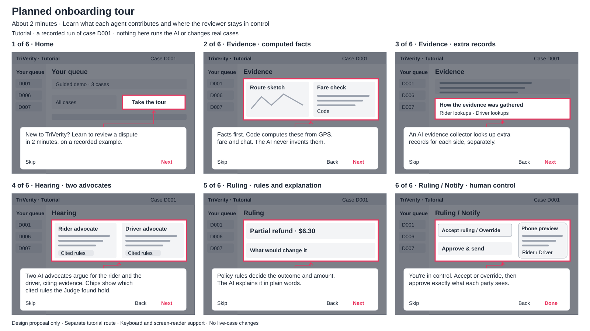

# Planned onboarding tour

## Who it is for and why

Reviewers at a ride-hailing company are customer-support and operations staff, often with
non-technical degrees, not AI engineers. The planned tour would teach reviewers, in about
2 minutes, what each agent contributes and where the human stays in control, before they handle
live disputes. It is a design proposal, not an implemented feature.

## What already helps reviewers

TriVerity already explains its work through:

- Plain-language rulings and messages for each party.
- Jargon tooltips on rule IDs and technical terms.
- “How this step was decided” on every step.
- AI / Fallback / Code badges showing how an output was produced.
- A five-step stepper that follows the review workflow.
- A guided demo path on the home page.

The tour would connect these explanations. It would be offered on the first visit and remain available through a “Take the tour” button on the home
page. It would be off in presentation mode so it cannot interrupt a live demonstration.

## The six steps

The storyboard is a simplified wireframe of the planned interaction, not a captured AI run.
Each frame dims the page around one highlighted area and places a short explanation beside it.

1. **Home — Take the tour.** “New to TriVerity? Learn to review a dispute in 2 minutes, on a recorded example.”
2. **Evidence — evidence cards.** “Facts first. Code computes these from GPS, fare and chat. The AI never invents them.”
3. **Evidence — How the evidence was gathered.** “An AI evidence collector looks up extra records for each side, separately.”
4. **Hearing — the two advocates.** “Two AI advocates argue for the rider and the driver, citing evidence. Chips show which cited rules the Judge found hold.”
5. **Ruling — outcome and What would change it.** “Policy rules decide the outcome and amount. The AI explains it in plain words.”
6. **Ruling / Notify — reviewer controls and phone preview.** “You're in control. Accept or override, then approve exactly what each party sees.”

## A recorded run, clearly labelled

The tour would replay a saved result from a recorded real run of sample case D001: route deviation,
with a partial refund of $6.30. “Real run” means an actual pipeline execution on the synthetic sample
case, not a real customer's dispute. The saved evidence, arguments, ruling and source badges would
remain intact, including any fallback labels. No AI output would be invented for the tutorial.

A persistent label would say: “Tutorial · a recorded run of case D001 · nothing here runs the AI or
changes real cases”. This makes the source and the interaction clear. The saved run must be captured and checked before shipping.

## Access and isolation

A separate route, such as `#/tour`, would use the saved result with every step unlocked. Tutorial
controls would affect only temporary tutorial state: no AI calls, live-case writes, messages,
appeals or precedent records. Exiting would discard that state and return to the previous page.

Each explanation card would have Next, Back and Skip controls. Focus would move into the card;
keyboard navigation and screen-reader announcements would identify its title and step number.
Background controls would be unavailable during the spotlight. Escape or Skip would exit and
restore focus to the entry control. Reduced-motion preferences would disable animated transitions.

## Out of scope

This proposal does not implement the route, capture the saved run, change agent behaviour, or add
production training, certification or analytics. It documents the interaction and its safeguards only.
