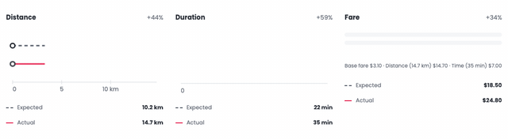
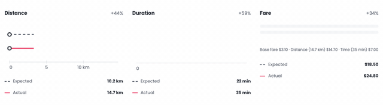
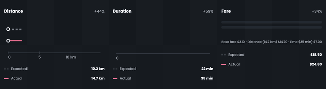
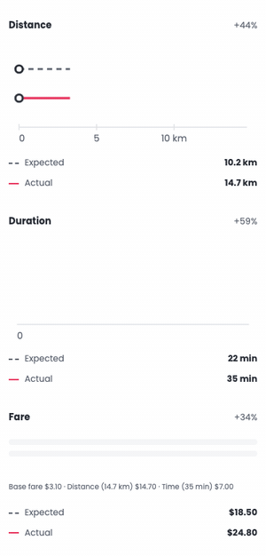

# "Case at a glance" chart intro — 16 October 2026

The three charts animate once, about 0.97 s in total, the first time a case is opened in a browser session. They play staggered left to right: Distance at 0 ms, Duration at 150 ms and Fare at 300 ms.

- **Distance:** the expected and actual lines draw together, then the thick extra segment continues and "+4.5 km" rises in.
- **Duration:** the dashed expected line draws, then the actual line traces left to right in time order. The "6-min stop" band fades in as the trace reaches it.
- **Fare:** the expected bar grows, the charged segments fill in order, then the marker and "+$6.30 above expected" fade in.

Timings are in `frontend/src/chartIntro.ts`; the components pass them to CSS as custom properties.

All captures are headless Chrome recordings of D001 at real speed unless marked; the GIFs loop for review only, while the intro itself plays once.

| View | Recording |
| --- | --- |
| Light, 1280 px |  |
| Light, 1280 px, half speed |  |
| Dark, 1280 px |  |
| Light, 375 px (stacked; same stagger) |  |

[A still from mid-intro](mid-intro-light-1280.png) shows that the expected lines keep their dashes while they are revealed.
