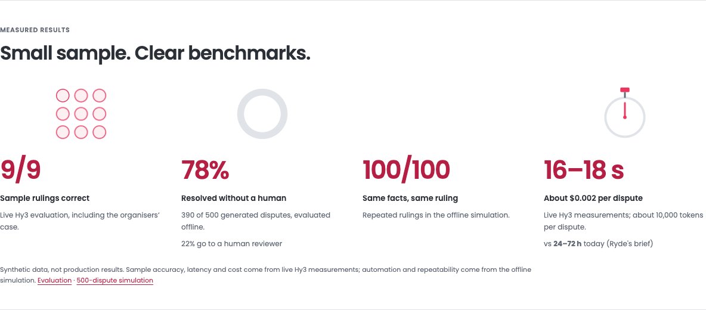

# Landing Results illustrations — 16 October 2026

Baseline: main at `dc0408d`, after trust tiles #75 merged. All captures use the offline frontend, without a backend. The landing page made zero `/api` requests and no LLM calls.

Each measurement has a decorative inline SVG: nine sample ticks, a 390/500 automation ring, 100 repeatability dots and a 17/60 stopwatch. Existing values, labels, details and the synthetic-data footnote are unchanged. Added captions name the 22% human-review share and the challenge brief's 24–72 hour comparison.

## Before / after

Chrome, explicit light/dark theme, 1280×900 or 375×900 viewport, cropped to the Results section. Reduced motion shows the final state for these static captures; phone Results remain two columns. The GIF captures real observer-triggered motion at 1280×720 with ordinary motion enabled. The clip loops for review; the actual page plays once per mount and does not replay on scrolling away and back.

| View | Before | After |
| --- | --- | --- |
| Desktop light | [Before](before-light-1280.png) | [After](after-light-1280.png) |
| Desktop dark | [Before](before-dark-1280.png) | [After](after-dark-1280.png) |
| Phone light | [Before](before-light-375.png) | [After](after-light-375.png) |
| Phone dark | [Before](before-dark-375.png) | [After](after-dark-375.png) |

## Verification

- `npm ci`, `npx tsc`, `npm test` (**121 passing**) and `npm run build` pass. Five new geometry tests cover the ordered sample IDs, 100 unique dot positions/rows, 390/500 ring proportions, 17/60 stopwatch arc/hand and viewBox bounds (including strokes and the hand's entire sweep).
- Real IntersectionObserver at threshold 0.3: 112 animation starts (9 ticks, 100 dots, 2 arcs, 1 hand), no new starts on returning to the section. Four columns stagger by 120 ms; tick/dot items stagger by 40 ms. Ticks finish in 720 ms, dots in 760 ms, rings/hand in 760 ms, excluding each column's delay. Only opacity, transform and stroke-dashoffset animate; all new keyframes have the `results-` prefix.
- Reduced motion on first load, reduced motion enabled during the session, and missing IntersectionObserver all show final geometry immediately. No start styles exist outside observer-added classes. The observer disconnects on first reveal and on cleanup.
- No horizontal overflow at 375/768/1280/1440 px. Normal/presentation modes checked; real observer playback in presentation mode checked at 375/1280 px in both themes. SVG boxes are 96 px desktop / 72 px phone, or 104/80 px in presentation mode.
- Four SVGs and their decorative definition wrappers are hidden from assistive technology. Chrome accessibility-tree inspection confirms the original measurement values remain exposed. No physical screen-reader listening session was performed. No new controls or tab stops; Evaluation link keyboard focus remains visible.
- Captions reuse the existing muted token; contrast is **5.69:1 light / 8.02:1 dark**, above 4.5:1 in both themes. Theme tokens only; no libraries, backend changes or extra API calls.

The hero, problem, workflow, trust tiles, Try cards, footer and console intro retain their existing rendering. No open questions. The case-card follow-up must start only after this PR merges.
