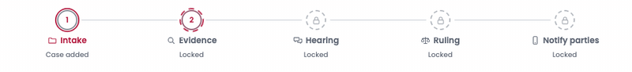

# Stepper shows the reviewer's progress — 16 October 2026

Before this change, every step showed a tick as soon as a ruling existed, so a case opened only at Evidence looked fully reviewed. The stepper now tracks what the reviewer has done; "agents finished" stays with the "Ruling ready" pill.

**When each step counts as reviewed**

- **Intake:** as soon as a ruling exists.
- **Evidence and Hearing:** once the reviewer has been on the step.
- **Ruling:** after an accepted or overridden decision is saved. If recording returns 403, as in the public demo, opening the step counts.
- **Notify parties:** once both phones have each been at least half in view.

**What the stepper shows**

- The connector line fills up to the furthest reviewed step.
- A "Next" hint marks the first step still to review.
- "Reviewed N of 5 steps" sits beside the status pill and becomes "Review complete ✓" when every step is done.
- During a live run, a dashed ring turns slowly on the step the agents are working on.
- The current step's ring draws itself once when the reviewer arrives, then stays still.

All captures are headless Chrome with AI Offline. Before is main at `02f278b` (#62), showing D003 right after a run.

| View | Before (right after a run) | After |
| --- | --- | --- |
| D003, light, 1280 px | [Before](before/D003-light-1280.png) | [Just ran](after/D003-light-1280.png) · [Ruling accepted](after/D003-ruling-accepted-light-1280.png) · [Review complete](after/D003-review-complete-light-1280.png) |
| D003, dark, 1280 px | [Before](before/D003-dark-1280.png) | [After visiting Hearing](after/D003-dark-1280-after-hearing.png) |
| D003, light, 375 px | [Before](before/D003-light-375.png) | [After visiting Hearing](after/D003-light-375-after-hearing.png) |
| D003, dark, 375 px | [Before](before/D003-dark-375.png) | [After visiting Hearing](after/D003-dark-375-after-hearing.png) |
| Presentation mode | | [After visiting Hearing](after/D003-presentation-1280-after-hearing.png) |

The live run below was slowed to one event every 700 ms so the working ring can be followed from Evidence to Hearing to Ruling:

Under reduced motion the working ring [shows dashed and still](after/reduced-motion-working.png).
