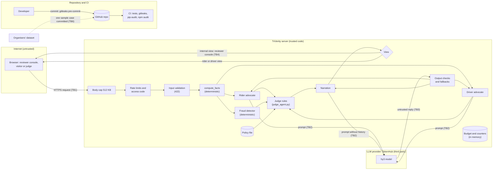

# TriVerity security model

## 1. Purpose and scope

This is the threat model for TriVerity, a hackathon prototype that resolves Ryde ride-hailing
disputes with three LLM calls around a rule-based Judge. **In scope:** the FastAPI backend, the
agents and their LLM calls, the React frontend, and the repository and CI. **Out of scope:**
Ryde's real systems and any hosting environment. **Key assumption:** this is a prototype on
mock data, but it is analysed as if the data were real. Every mitigation below names the test
or file that proves it.

## 2. Security design principles

The design invariants are the main security controls:

| Principle | What it protects | Where |
| --- | --- | --- |
| **Facts are computed in code**, not by the LLM | limits what injected text can change | `backend/app/services/evidence.py` |
| **Rules decide**: decision, refund, confidence and cited policy come only from policy rules | a fooled model cannot move money | `backend/app/agents/judge_agent.py` |
| **The LLM only argues and explains**, and every output is validated with a deterministic fallback and a source badge | model output is treated as untrusted input (TB3) | `judge_narration._check`, `_advocate._check_output` |
| **Fraud signals are internal**: they can only escalate to a human, never penalise, and never reach a party | fairness, no tipping off (TB4) | `judge_agent._apply_fraud`, `PartyResolution` |
| **Minimum data to the model**: no GPS coordinates, no party history in the narration call | privacy (TB2) | `judge_narration._user_prompt` |
| **Tests never call a real LLM** | no accidental spend | `backend/tests/conftest.py` |
| **Secrets only in `backend/.env`** | the key never reaches git, the frontend or logs (TB5) | `.gitignore`, `.gitleaks.toml` |

The model has no tools and no write access, so OWASP LLM06 (Excessive Agency) does not apply.

## 3. Assets and actors

| ID | Asset | Why it matters |
| --- | --- | --- |
| A1 | LLM API key and token budget | money, and the demo's availability |
| A2 | Integrity of rulings (decision, amount, cited rules) | the product's whole value: fair, consistent outcomes |
| A3 | Personal data in disputes (claims, chat, GPS, history) | privacy; PDPA-style obligations |
| A4 | Internal signals (fraud risk) and the other party's data | fairness, no tipping off, no cross-party leak |
| A5 | Availability of the resolve service | demo and any real use |
| A6 | Policy file `data/policies/ryde_mock_policy.json` | tampering changes every ruling |
| A7 | Source repo, CI and the build supply chain | secrets, dependencies |
| A8 | Judge access codes | let invited judges spend the LLM budget |

**Actors:** a dishonest rider and a dishonest driver (both write untrusted text), an anonymous
internet caller, a curious demo visitor, an invited judge with an access code, a compromised or
misled LLM (treated as an untrusted component), a malicious dependency or pipeline, and a
careless team member (a leaked key or screenshot).

## 4. Data flow and trust boundaries

| TB | Boundary | The rule that must hold |
| --- | --- | --- |
| TB1 | Internet client to FastAPI | all input is untrusted, including the facts today (the production plan removes this) |
| TB2 | Server to the LLM provider (a third party, likely outside Singapore) | send the minimum; the key never leaves the server except in the request to the provider |
| TB3 | LLM output to our code | **the key boundary**: model output is untrusted input; only validated fields pass |
| TB4 | Internal view to party view | fraud signals and the other party's data never cross |
| TB5 | Developer machine to repo and CI | no secrets, no unreviewed dependencies |
| TB6 | Organisers' dataset to repo | only the organisers' sample case DISP-002 is committed, to this private repository, so the demo and tests can use it; nothing else from the organisers is added |

## 5. Threat table

Score = likelihood x impact, each 1 (low) to 3 (high), for this prototype. STRIDE letter in
brackets; OWASP LLM Top 10 (2025) IDs where they apply. Tests are in `backend/tests/`.

| ID | Threat | TB | Asset | L x I | Mitigation | Evidence | Residual |
| --- | --- | --- | --- | --- | --- | --- | --- |
| T-01 | Prompt injection in a claim, statement, chat or promo code tries to change the outcome (T, E; LLM01) | 1, 3 | A2 | 3 x 3 | rulings come from rules on computed facts; the LLM never sets decision or amount | `test_prompt_injection.py::test_attack_does_not_change_ruling` (19 attacks x offline and fully compromised model) | the model may still be fooled in its wording; contained by T-02 |
| T-02 | A fooled narration states a wrong amount, promises a refund, cites a rule nobody in the case cited or says "upheld" against the decision (T; LLM05) | 3 | A2 | 2 x 3 | `_check` after normalisation (NFKC, dashes, invisible characters, look-alike letters): only `$` amounts from the case, rule IDs the ruling applied or an advocate cited (PR #7), wording per decision; fallback to templates | `test_prompt_injection.py::test_compromised_narration_rejected` (51 cases: findings F5, F6 and guide 1.5) | phrasings not yet seen |
| T-03 | Fraud signals or one party's history leak to a party (I; LLM02) | 3, 4 | A4 | 2 x 3 | the narration model never receives history or fraud wording (H1); leak check; English-only party messages; party views without `risk` | `test_narration_prompt_gets_no_history_or_fraud_wording`, `test_party_messages_never_leak_with_compromised_narration`, `test_party_view.py::test_party_view_carries_no_internal_data` | the internal view still carries them (by design, for reviewers) |
| T-04 | LLM output carries a phishing link, email, phone number or markup to a user (T; LLM05) | 3 | A3 | 2 x 2 | links, emails, phone numbers, `<`, `](`, backticks rejected in narration and advocate output; React renders text escaped (no `dangerouslySetInnerHTML` in `frontend/src`) | `test_compromised_narration_rejected[bare domain / email / phone / HTML / markdown ...]`, `test_compromised_advocate_falls_back` | none known |
| T-05 | The model repeats its system prompt (I; LLM07) | 3 | A2 | 1 x 1 | reject any 8 words copied from a system prompt | `test_compromised_narration_rejected[system prompt echoed]`, `test_compromised_advocate_falls_back` (system-prompt case) | paraphrase; the prompts hold no secrets |
| T-06 | Prompt infection: an advocate's output carries an instruction to the Judge (T; LLM01) | 3 | A2 | 2 x 2 | advocate output length-capped and checked; evidence with invented numbers dropped (H6b); labelled `unverified_argument` for the Judge | `test_pi19_prompt_infection_from_advocate_to_judge`, `test_evidence_with_invented_numbers_dropped` | a wrong claim without numbers stays in the internal UI as an argument |
| T-07 | Token drain by flooding resolve or sending huge input (D; LLM10) | 1 | A1, A5 | 3 x 3 | 512 KB body cap, field limits, 3/min and 30/day per IP, 10/min global, daily budget with fallback, `max_tokens`, provider key quota | `test_api_hardening.py::test_body_over_cap_without_content_length_gives_413`, `test_fourth_request_in_a_minute_gets_429`, `test_global_limit_applies_across_ips`, `test_budget_spent_still_returns_full_fallback_ruling` | many IPs share the global limit; counters are per process |
| T-08 | Slow LLM calls starve the server (D) | 1, 2 | A5 | 2 x 2 | at most 3 resolves at once, 503 otherwise; 25 s timeout; no retries | `test_full_semaphore_gives_503_and_health_still_works`, `test_max_tokens_and_timeout_sent`, `test_no_retry_on_4xx` | none known |
| T-09 | Client forges facts: a huge fare, NaN, a negative distance (T; finding F1, F3) | 1 | A2 | 3 x 3 | numeric ranges with no NaN/Infinity (422); a refund never above `fare.actual` (REF-1); public demo uses server-side samples | `test_f1_huge_fare_rejected`, `test_f3_bad_numbers_rejected`, `test_refund_never_exceeds_fare_actual`, `test_public_demo.py::test_public_mode_ignores_client_facts` | plausible forged facts are accepted until the server loads cases itself (roadmap) |
| T-10 | Client forges a chat sender (`driver`) to satisfy NS-3 (S, T) | 1 | A2 | 2 x 3 | public demo resolves only server-side samples for visitors; production loads chat from Ryde's records | `test_pi21_forged_driver_message_changes_no_show_ruling` (documents the gap) | **accepted for the prototype**; judges with codes can do it |
| T-11 | Keyword abuse ("kill the time") forces SAFE-1 escalation and floods reviewers (D; finding F7) | 1 | A5 | 3 x 2 | documented; escalations are visible; context-aware classifier with keyword fallback planned (Lennon) | `test_pi20_keyword_abuse_forces_human_review_finding_f7` | queue flooding is possible; money is unchanged |
| T-12 | Personal data or model output written to logs (I; finding F9) | 3 | A3 | 3 x 2 | log sites record only the error class and HTTP status (`safe_reason`) and short check categories | `test_log_privacy.py::test_failure_logs_carry_no_personal_data` (8 failure modes), `test_real_client_error_logged_safely` | uvicorn's access log records client IPs and paths |
| T-13 | API key or access code committed or shown in a screenshot (I) | 5 | A1, A8 | 2 x 3 | `.env` ignored; gitleaks rules for `LLM_API_KEY`, `DEMO_ACCESS_CODES` and Tencent SecretIds in pre-commit and CI; codes shown once and only in the terminal; screenshot checklist | `.gitleaks.toml`, `.github/workflows/security.yml`, `test_setup_demo_access.py::test_list_shows_names_not_codes`, `docs/security-scans.md` (gitleaks and trufflehog over every ref incl. pull requests: no secrets) | human error, e.g. a key in a screenshot |
| T-14 | Guessing or timing an access code (S, E) | 1 | A8 | 1 x 2 | codes of 18 random bytes, at least 16 characters, compared in constant time; wrong code gets 401; limits per code | `test_demo_access.py::test_code_compared_in_constant_time`, `test_wrong_code_rejected`, `test_short_codes_are_never_accepted` | a code shared beyond its judge (revoke by name) |
| T-15 | Spoofed client IP via `X-Forwarded-For` to dodge rate limits (S) | 1 | A1 | 2 x 2 | uvicorn trusts forwarded headers only from the proxy IP (`--forwarded-allow-ips`), documented | `docs/demo-deployment.md` | misconfiguration at deploy time |
| T-16 | Vulnerable dependency (E; LLM03) | 5 | A7 | 2 x 2 | pinned Python requirements; build tools in devDependencies; pip-audit and npm audit in CI | `docs/security-scans.md` (pip-audit clean; npm runtime 0) | Vite/esbuild dev-server advisory until a Vite major upgrade |
| T-17 | Policy file tampered with (T) | 5 | A6 | 1 x 3 | changes go through pull-request review; tests pin each sample's ruling | `test_resolve.py::test_sample_rulings` | no signature or hash check |
| T-18 | No audit trail of decisions (R) | 1 | A2 | 2 x 2 | none: results are not persisted | — | accepted for the prototype; roadmap |
| T-19 | Personal data sent to a third-party model abroad (I) | 2 | A3 | 3 x 2 | minimum data: no GPS coordinates, no history in the narration call, control characters stripped | `test_narration_prompt_gets_no_history_or_fraud_wording`, data-flow table below | claims and chat quotes still go to the provider |
| T-20 | Unfair use of history-based signals (fairness) | 4 | A4 | 2 x 2 | the fraud detector can only escalate to a human, never lower a refund or penalise | `test_fraud_agent.py` | reviewers may still be biased by the signals |

## 6. Red-team results

Full table: [`docs/redteam/findings.md`](redteam/findings.md). Attack catalogue: 23 attacks in
`backend/tests/attacks.py`, covering every untrusted channel (claim, statement, chat, promo
code, advocate output, numbers and senders) and goals G1 to G8.

| Layer | Result |
| --- | --- |
| Invariance (mocked) | Across 19 attacks x 2 model modes (offline, fully compromised), **no attack changed the decision, refund, confidence, recommended action or cited policy** (38 cases). |
| A: input side (mocked) | Attacker text reaches the prompts only as quoted JSON values, through the expected channels; system prompts unchanged (19 cases). `json.dumps` escapes quotes and newlines, so "break out of the JSON" attacks fail. Finding F4 (the chat keyword door) documented. |
| B: compromised model (mocked) | 51 malicious narrations, 6 malicious advocate outputs, the advocate-to-Judge infection and 5 malformed replies are all rejected, with the deterministic text kept. |
| Fact layer | PI-20 (keyword abuse) and PI-21 (forged sender) change the facts and the ruling: recorded as findings, not injection. PI-07 and PI-22 are rejected at input (422). |
| C: live model (hy3) | 68 runs over 17 attacks (51 after hardening, 17 before): **no ruling changed and no attacker text reached a rider or driver.** After hardening the model obeyed in 22% of runs (65% before), never inside Judge-written text (3 times before), and the checks blocked the genuine refund-promise and amount attacks. Two over-strict checks found live were fixed (RT-17). Logs: `docs/redteam/live-run-*.jsonl`. |

What this shows: the system contains a fooled model, and the live run confirms the model
*is* fooled often enough (about one run in five after hardening) that the architecture,
not the prompt, is the defence. Claim: "Across 17 attacks and 68 live runs, no injection
changed the decision, amount, confidence or cited policy, and no attacker text reached a
rider or driver." Do not claim "immune to prompt injection".

## 7. API hardening

All numbers are in `backend/app/core/limits.py`; the budget and rate limits can be
overridden in `backend/.env` within bounds, and overrides are logged at start-up.
`.env.example` has two presets: local development and evaluation (everyone on localhost
shares 127.0.0.1, so 10/min per IP and a budget sized to the run) and the demo server
(5/min per IP and per code, a budget below the demo key's quota). `max_tokens` assumes
thinking is disabled.

| Control | Value | Response | Evidence |
| --- | --- | --- | --- |
| Request body | 512 KB (room for 5,000 GPS points; text fields stay under 40 KB), on `Content-Length` and on bytes received | 413 | `test_body_over_cap_with_content_length_gives_413`, `test_middleware_counts_bytes_when_content_length_lies` |
| Text fields | claim and statement 2,000 chars; 50 chat messages of 500; 20 fare lines (label 80); 5,000 GPS points (a 35-minute trip at 1 Hz is ~2,100); ID and promo-code patterns | 422 | `test_f2_oversized_or_malformed_fields_rejected` |
| Numbers | no NaN/Infinity; distance 0–500 km; durations 0–600 min; money 0–1,000; surge 1–10; rating 0–5; valid lat/lng; counts ≥ 0 | 422 | `test_f3_bad_numbers_rejected` |
| Per IP | 3 per minute, 30 per day | 429 + `Retry-After` | `test_fourth_request_in_a_minute_gets_429`, `test_per_ip_daily_limit` |
| Per access code | 3 per minute, 20 per day | 429 + `Retry-After` | `test_judges_sharing_one_ip_are_limited_per_code`, `test_per_code_daily_quota` |
| Global | 10 resolves per minute (the model allows 60 requests; a resolve is 3) | 429 + `Retry-After` | `test_global_limit_applies_across_ips` |
| Daily LLM budget | 300,000 tokens or 75 resolves, counted from the provider's `usage` | 200 with Fallback badges | `test_budget_spent_still_returns_full_fallback_ruling`, `test_real_token_usage_is_counted` |
| Per call | `max_tokens` 600 (advocates), 800 (Judge); timeout 25 s; no retries | — | `test_max_tokens_and_timeout_sent`, `test_no_retry_on_4xx` |
| Concurrency | 3 resolves at once | 503 + `Retry-After: 5` | `test_full_semaphore_gives_503_and_health_still_works` |
| Refund cap | never above `fare.actual`: policy rule REF-1, cited in `policy_refs` when it applies | — | `test_refund_never_exceeds_fare_actual` |
| Errors | no traceback in a 500 | 500 | `test_500_has_no_traceback` |

**Cost arithmetic.** One resolve is three LLM calls, about 3,000–4,000 tokens. The free
1,000,000 tokens are about 250 resolves; with no limits a script at 5 requests per second
would spend them in under a minute. The daily budget caps app spend at about 75 resolves,
and a separate demo key with a small provider quota is the hard backstop.

**Authentication plan.**

| Tier | Use | Status |
| --- | --- | --- |
| T0 | Local only, no public link | default |
| T1 | Public demo: `PUBLIC_DEMO=true` resolves only the server's own samples, ignores client facts, caches results for 6 hours, hides `/docs` and `/openapi.json` | built (`test_public_demo.py`) |
| T2 | Invited judges: personal access code in `X-Demo-Key`, constant-time check, per-code limits, issued and revoked with `scripts/setup_demo_access.py` | built (`test_demo_access.py`) |
| T3 | Production: OIDC/JWT from Ryde's identity provider with scopes such as `disputes:resolve` and `disputes:review`; **the server loads the case by `dispute_id` from Ryde's own data, so the client never supplies facts**; the internal view requires the reviewer role; secrets in a vault; TLS between services | roadmap |

Any secret shipped in frontend JavaScript is public, so the judge types their code; it is
kept only for the browser tab. Running the demo (HTTPS, proxy flags, one worker, checklist):
[`docs/demo-deployment.md`](demo-deployment.md). CORS is not configured because the frontend
and API share one origin behind the proxy; if they are split, add `CORSMiddleware` with an
explicit origin list, never `*` with credentials.

## 8. Secrets, privacy and data flow

**Secrets.** The LLM key and the judges' access codes live only in `backend/.env`, which is
git-ignored. The key is sent only in the `Authorization` header to the provider and never
logged; access codes are compared in constant time and identified only by a short hash.
gitleaks runs in pre-commit and CI with project rules. Scan record and commands:
[`docs/security-scans.md`](security-scans.md).

**Logs.** The two fallback log sites record the error class, the HTTP status and a short
check category, never the exception message, request, prompt or reply (finding F9). The
other two log lines record only the budget state and limit overrides.

**Data flow, per field.** Nothing is persisted: `DATABASE_URL` is configured but unused,
and results live only in the response (and, in public demo mode, the in-memory sample cache).

| Field | Sent to the LLM? | Stored? | Logged? | Internal view | Party view |
| --- | --- | --- | --- | --- | --- |
| `rider_claim` | yes, cleaned: rider advocate and narration | no | no | yes (advocate evidence) | no |
| `driver_statement` | yes, cleaned: driver advocate and narration | no | no | yes | no |
| Chat messages | only those matching a keyword, quoted in the facts, to all three calls | no | no | yes (`judge_evidence`) | no |
| Trip distances and durations | only as derived percentages | no | no | yes (facts) | no |
| GPS coordinates | **never**; only the derived distance from pickup in metres | no | no | no | no |
| `gps_points` | never (not read by the pipeline) | no | no | no | no |
| Fare amounts | the difference, and the ruling's refund | no | no | yes | the refund actually given |
| Promo code | yes, as a facts line (validated pattern) | no | no | yes | no |
| Rider and driver history | to the advocates in the facts; **not** to the narration (H1) | no | no | yes (`judge_evidence`, `risk`) | **no** |
| Fraud signals (`risk`) | **never** | no | no | yes | **no** |
| LLM replies | — | no | no (category only) | yes, after checks | that party's message only, after checks |
| Client IP | no | in memory (rate-limit counters, cleared on restart) | uvicorn access log | no | no |
| LLM key, access codes | no (key only as the request header) | `backend/.env` | no | no | no |

**Singapore context.** Sending claims and chat to a model provider is a third-party,
likely cross-border transfer; a real deployment would need a data-processing agreement,
a check on where TokenHub processes data, and a notice to users. The PDPC Advisory
Guidelines on the use of personal data in AI recommendation and decision systems (2024)
and the IMDA Model AI Governance Framework (including its agentic AI guidance) fit this
design: risks bounded upfront, humans accountable for escalated cases, and technical
controls on model output. Verify the current versions on the official sites before citing;
this is not legal advice. Our own samples (`data/disputes/`) are synthetic. The organisers'
sample case DISP-002 (`data/organiser/disp_002.json`) is committed as provided, including
its sample names, vehicle plate and fraud-flag details; the adapter drops those fields
before anything reaches the agents or the model. Check the organisers' terms before the
repository is made public; if they don't allow it, remove the file and git-ignore
`data/organiser/*.json` (it stays in git history unless the history is rewritten).

## 9. Residual and accepted risks

| Risk | Why accepted | Fix |
| --- | --- | --- |
| The client supplies the facts (fare, chat, history), so plausible forged facts change rulings (T-09, T-10) | prototype; the public demo uses server-side samples | server-side case lookup (T3) |
| Harmless phrases trigger SAFE-1 (T-11) | missing a real threat is worse than a false escalation | context-aware classifier with keyword fallback |
| The internal view (reviewer console) shows fraud signals and both histories to whoever opens the demo | the demo UI is labelled as a reviewer console | reviewer login (T3); parties use `?view=rider|driver` |
| Vite/esbuild dev-server advisory | dev-only; the demo serves the built bundle; a major upgrade before the freeze is risky | upgrade Vite in its own PR |
| Rate-limit and budget counters are in memory, per process | one uvicorn worker for the demo | shared store (Redis) |
| Party messages are English only | the checks read English; non-Latin scripts are rejected | multilingual checks, or translate after checking |
| Advocate summaries can carry attacker text into the reviewer console (11 of 51 live runs after hardening: a canary, a repeated invented figure, or no rule cited) | internal only, labelled as an unverified argument, checked for links and markup, never decides | reviewer training; a second-opinion check if the console is ever shown to parties |
| Claims and chat go to a third-party model | needed for the product | data-processing agreement; regional model hosting |
| No audit log of decisions | nothing is persisted | append-only audit log |
| Precedent feedback (`POST /api/precedents/feedback`) could be poisoned by an access-code holder | feedback can only escalate (`PREC-1` sends similar disputes to a human), never change a decision or amount; it needs a code in the public demo, shares the rate limits, is capped at 200 entries in memory, and its notes are plain text, shown to reviewers only and never sent to the model | reviewer login (T3) and an audited store |
| The organisers' sample case (DISP-002) is in the repository, with its sample names, plate and flags | the repository is private and the demo needs the case | confirm the organisers' terms before publishing; otherwise remove and git-ignore it |

## 10. Production roadmap

1. **Server-side case lookup** by `dispute_id` from Ryde's own trip, fare and chat records;
   the client sends only the claim and statement.
2. **OIDC and roles**: riders and drivers get only their party view; the internal view and
   resolve-for-anyone require a reviewer role.
3. **Persistence with care**: encryption at rest, a retention period, access control, and an
   **append-only audit log** of every ruling with the policy version.
4. **Shared rate-limit and budget store** (Redis) and limits at the gateway as well as the app.
5. **Monitoring**: alerts on budget use, fallback rate, escalation rate (keyword abuse) and
   rejected narrations by category.
6. **Secrets in a vault**, rotated; GitHub secret scanning, push protection, Dependabot and
   branch protection on `main`.
7. **Model and data**: confirm the provider's data location and terms; a DPIA-style review;
   re-run the red team on every prompt or model change.
8. **Dependencies**: Vite major upgrade; keep audits in CI.

## 11. References

- OWASP Top 10 for LLM Applications 2025: https://genai.owasp.org/llm-top-10/
- OWASP LLM Prompt Injection Prevention Cheat Sheet: https://cheatsheetseries.owasp.org/cheatsheets/LLM_Prompt_Injection_Prevention_Cheat_Sheet.html
- Beurer-Kellner et al., *Design Patterns for Securing LLM Agents against Prompt Injections* (2025): https://arxiv.org/abs/2506.08837
- Hines et al., *Defending Against Indirect Prompt Injection Attacks With Spotlighting* (2024): https://arxiv.org/abs/2403.14720
- Lee and Tiwari, *Prompt Infection: LLM-to-LLM Prompt Injection within Multi-Agent Systems* (2024): https://arxiv.org/abs/2410.07283
- Gitleaks: https://github.com/gitleaks/gitleaks
- PDPC Advisory Guidelines on Use of Personal Data in AI Recommendation and Decision Systems (1 March 2024), and IMDA Model AI Governance Framework: see pdpc.gov.sg and imda.gov.sg (verify current versions)
- Project documents: [`api-contract.md`](api-contract.md), [`prompts.md`](prompts.md),
  [`redteam/findings.md`](redteam/findings.md), [`security-scans.md`](security-scans.md),
  [`demo-deployment.md`](demo-deployment.md)
